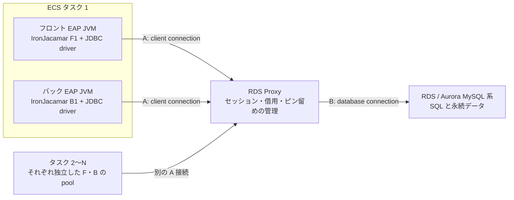

# ECS 上の JBoss EAP 8.1 と RDS Proxy の接続プール

確認日：2026-10-14

フロント・バック双方が RDS Proxy に直接接続する MySQL 系構成を対象にする。実環境の設定・メトリクスは未提供で、数値は説明用。Excel と同じ本文・設定表・出典を収録する。Excel の計算欄は編集して再計算できるが、この Markdown の計算例は初期値の静的な説明。

## 目次

- 00 はじめに
- 01 構成と動作図
- 02 歴史と必要性
- 03 何を保持するか
- 04 貸出から返却
- 05 取引とピン留め
- 06 EAP設定
- 07 Proxy設定
- 08 JDBCとDB設定
- 09 容量計算
- 10 時間と障害
- 11 認証と境界
- 12 監視と切り分け
- 13 確認と設定例
- 14 設計とFAQ
- 15 用語と出典

## 00 はじめに

確認日 2026-10-14。対象は ECS タスク内のフロント・バック各コンテナの JBoss EAP 8.1。両方が JDBC で RDS Proxy に直接接続する。

### 何を再利用する？

すでにつながっている「会話の通り道」を繰り返し使う。

接続には通信路、認証済みの状態、設定、管理情報が付く。接続先の住所だけを保存する仕組みではない。毎回 TCP・TLS・認証をやり直す負担を減らす。 [J1](https://docs.oracle.com/javase/tutorial/jdbc/basics/sqldatasources.html) [A1](https://docs.aws.amazon.com/AmazonRDS/latest/UserGuide/rds-proxy.howitworks.html)

### IronJacamar の仕事

各教室にある「電話の貸出係」。

各 EAP JVM 内で JDBC 接続を貸し出し、返却・上限・待機・故障確認・トランザクションとの連携を管理する。この構成の物理接続先は Proxy。 [R1](https://docs.redhat.com/en/documentation/red_hat_jboss_enterprise_application_platform/8.1/html/performance_tuning_for_red_hat_jboss_enterprise_application_platform/assembly-datasource-resource-adapter-tuning_performance-tuning-guide) [R4](https://docs.redhat.com/en/documentation/red_hat_jboss_enterprise_application_platform/8.1/html/configuration_guide/jakarta-connectors-management_orb-configuration)

### RDS Proxy の仕事

学校全体の「電話交換室」。

複数タスク・複数 JVM からの接続を受け、DB への接続を管理する。条件が合えば、DB 側の一本を別のクライアントの次の取引にも利用する。 [A1](https://docs.aws.amazon.com/AmazonRDS/latest/UserGuide/rds-proxy.howitworks.html)

### なぜ二つ必要？

教室内の貸し借りと、学校全体の回線配分は役割が違う。

IronJacamar はアプリの近くで接続の作成と同時利用を抑える。Proxy は DB の近くで複数アプリからの接続をまとめる。追加の通信経路・費用と、接続管理の便益を負荷試験で比較する。 [R1](https://docs.redhat.com/en/documentation/red_hat_jboss_enterprise_application_platform/8.1/html/performance_tuning_for_red_hat_jboss_enterprise_application_platform/assembly-datasource-resource-adapter-tuning_performance-tuning-guide) [A1](https://docs.aws.amazon.com/AmazonRDS/latest/UserGuide/rds-proxy.howitworks.html) [A2](https://docs.aws.amazon.com/AmazonRDS/latest/UserGuide/rds-proxy-connections.html)

### フロントとバック

同じタスクに住んでいても、別々の電話棚を持つ。

本書は各コンテナに JVM が一つ、データソースが一つあるモデルから始める。JVM・データソース・資格情報別サブプールが増えれば数え直す。同一 JNDI 名でも別 JVM の棚は共有されない。 [R2](https://docs.redhat.com/zh-cn/documentation/red_hat_jboss_enterprise_application_platform/8.1/html/configuration_guide/datasource_parameters) [J1](https://docs.oracle.com/javase/tutorial/jdbc/basics/sqldatasources.html)

### 最も大切な区別

借りた電話を棚に返すことと、電話線を抜くことは違う。

Connection.close() は通常、論理ハンドルを閉じる。物理的なアプリ→Proxy 接続は再利用される。Proxy のピン留めは、その物理セッションが続く限り残り得る。 [J2](https://docs.oracle.com/en/java/javase/17/docs/api/java.sql/javax/sql/PooledConnection.html) [A2](https://docs.aws.amazon.com/AmazonRDS/latest/UserGuide/rds-proxy-connections.html) [A3](https://docs.aws.amazon.com/AmazonRDS/latest/UserGuide/rds-proxy-pinning.html)

### DB の前提

MySQL 系を対象とする。

RDS for MySQL、RDS for MariaDB、Aurora MySQL は Proxy の EngineFamily=MYSQL を使う。製品・バージョン・リージョン・ドライバーは同一ではない。細かな適用条件は各環境で照合する。 [A8](https://docs.aws.amazon.com/AmazonRDS/latest/UserGuide/Concepts.RDS_Fea_Regions_DB-eng.Feature.RDSProxy.html) [A9](https://docs.aws.amazon.com/AmazonRDS/latest/APIReference/API_CreateDBProxy.html) [J6](https://mariadb.com/docs/connectors/mariadb-connector-j/about-mariadb-connector-j)

### 値の読み方

「公式の値」「計算用の例」「自分の実測」を分ける。

本書には実環境の設定ファイル・メトリクスが提供されていない。設定例は検証用の仮値。EAP の既定値は管理モデル、未定義属性の実効値、コンテナ起動時の上書きを分けて確認する。 [R2](https://docs.redhat.com/zh-cn/documentation/red_hat_jboss_enterprise_application_platform/8.1/html/configuration_guide/datasource_parameters) [R5](https://access.redhat.com/webassets/avalon/d/red_hat_jboss_enterprise_application_platform/8.0/mgmt_model/subsystem/datasources/data-source/ExampleDS/index.html)

### 読む順番

最初は 01～05、設定作業では 06～14。

01 構成図、02 歴史、03 保持対象、04 接続の一生、05 取引とピン留め、06～08 設定、09 計算、10 時間と障害、11 認証、12 監視、13 コマンド、14 設計確認、15 用語と出典。

## 01 構成と動作図

A はアプリ→Proxy のクライアント接続。B は Proxy→DB の DB 接続。同じ「接続」でも区間が違う。



### ECS タスク 1

フロント EAP JVM とバック EAP JVM

ECS は入れ物の起動・配置・停止を担当する。Java オブジェクトのプールを二つのコンテナ間で共有する機能ではない。

### フロント JVM

アプリ → DataSource → IronJacamar → JDBC driver

フロント用のプール F が A 接続を保持する。画面要求を処理する間ずっと接続を借りる必要はなく、DB を使う範囲へ狭める。 [R1](https://docs.redhat.com/en/documentation/red_hat_jboss_enterprise_application_platform/8.1/html/performance_tuning_for_red_hat_jboss_enterprise_application_platform/assembly-datasource-resource-adapter-tuning_performance-tuning-guide) [J1](https://docs.oracle.com/javase/tutorial/jdbc/basics/sqldatasources.html)

### バック JVM

アプリ → DataSource → IronJacamar → JDBC driver

バック用のプール B が別の A 接続を保持する。業務処理が長いときも、外部 API 待ちの間まで DB 接続やトランザクションを保持しない設計を検討する。 [R1](https://docs.redhat.com/en/documentation/red_hat_jboss_enterprise_application_platform/8.1/html/performance_tuning_for_red_hat_jboss_enterprise_application_platform/assembly-datasource-resource-adapter-tuning_performance-tuning-guide) [J1](https://docs.oracle.com/javase/tutorial/jdbc/basics/sqldatasources.html)

### タスク 2～N

F2・B2、F3・B3 … の独立した棚

最大接続数は一つの設定値で全 ECS を制限するのではない。例えば 6 タスクで各フロント 20、各バック 30 なら、単純モデルの A 接続上限合計は 300。

### RDS Proxy

A 接続を受け、B 接続を割り当てる

一つの B 接続で二つのトランザクションを同時実行する意味ではない。取引が終わり安全になった時間帯に、別のクライアントへ貸し替える。 [A1](https://docs.aws.amazon.com/AmazonRDS/latest/UserGuide/rds-proxy.howitworks.html)

### RDS／Aurora

SQL を実行する本物の DB

表・行・索引・ロック・取引の確定結果を持つ。Proxy を入れても SQL 自体の計算量や DB の処理能力は無限にならない。

### アプリ間の HTTP

フロント → バックの API 接続がある場合

HTTP の Keep-Alive プールは JDBC プールとは別物。フロントの JDBC Connection オブジェクトを HTTP 経由でバックへ渡して使うことはできない。

### 境界ごとの故障

A が切れる、B が切れる、DB が遅い

A の切断は JDBC の再接続が必要。B の切断や DB 切替を Proxy が吸収できる場合もある。実行中の取引・SQL は失敗し得るため、同じ扱いにしない。 [A1](https://docs.aws.amazon.com/AmazonRDS/latest/UserGuide/rds-proxy.howitworks.html) [A2](https://docs.aws.amazon.com/AmazonRDS/latest/UserGuide/rds-proxy-connections.html)

## 02 歴史と必要性

年表の前半は技術の発展を説明する時代区分。特定製品の発明年と、標準化・公開日の記録を混同しない。

### 初期の DB 接続

使うたびに電話をかけ直すと遅い。

接続確立には通信・認証・サーバー側の作業領域準備がある。短い SQL を大量に実行する Web サービスでは、接続準備の割合が大きくなる。 [J1](https://docs.oracle.com/javase/tutorial/jdbc/basics/sqldatasources.html)

### JDBC と DataSource

DB ごとに接続コードを作るのは大変。

JDBC が Java から DB を操作する共通の窓口を提供。DataSource とプール対応実装により、アプリが利用し終えた接続をインフラ側で再利用しやすくなった。 [J1](https://docs.oracle.com/javase/tutorial/jdbc/basics/sqldatasources.html) [J2](https://docs.oracle.com/en/java/javase/17/docs/api/java.sql/javax/sql/PooledConnection.html)

### J2EE 1.3 の時代

DB 以外の業務システム接続でも、管理がばらばら。

Connector API が企業システム連携の標準となる。接続管理・トランザクション・セキュリティ等の共通の約束により、アプリサーバーとリソースアダプターの役割を分離した。 [H1](https://jakarta.ee/specifications/platform/8/platform-spec-8)

### 2011 年の IronJacamar

JBoss の接続管理を体系的に提供する。

JBoss 公式配布リポジトリには、2011-07-07 付けの IronJacamar 1.0.0.Final の JDBC 配布物がある。これは公開物の記録であり、接続プールそのものの発明日ではない。 [H2](https://repository.jboss.org/org/jboss/ironjacamar/ironjacamar-jdbc/1.0.0.Final/)

### WildFly・EAP へ

Java の業務アプリで接続管理を共通化する。

IronJacamar は JCA コンテナとしてアプリサーバーに組み込まれた。EAP 8.1 でも Jakarta Connectors とリソース管理の文脈に登場する。EAP 同梱版は製品パッチに依存する。 [H3](https://www.ironjacamar.org/doc/userguide/1.1/en-US/pdf/IronJacamarUserGuide.pdf) [R4](https://docs.redhat.com/en/documentation/red_hat_jboss_enterprise_application_platform/8.1/html/configuration_guide/jakarta-connectors-management_orb-configuration)

### コンテナ・自動伸縮

教室が急に増えると、各教室の電話棚も増える。

各 JVM に 30 本の棚があると、100 JVM では合計 3,000 本になり得る。各 JVM の最適化だけでは、共有 DB 全体への接続増を抑えきれない。

### 2019 年プレビュー

Lambda・ECS・Fargate 等から接続が集中する。

RDS Proxy が登場。複数アプリの近くではなく、共通の DB の手前で接続を再利用し、突発的な接続作成の負担を吸収する。 [A13](https://aws.amazon.com/blogs/aws/amazon-rds-proxy-now-generally-available/)

### 2020-06-30

Proxy 自体の冗長化や運用も任せたい。

RDS Proxy が MySQL・PostgreSQL 向けに一般提供。複数 AZ のマネージドな構成により、接続プールの運用と DB 切替対応をサービス側へ寄せる。 [A13](https://aws.amazon.com/blogs/aws/amazon-rds-proxy-now-generally-available/) [A1](https://docs.aws.amazon.com/AmazonRDS/latest/UserGuide/rds-proxy.howitworks.html)

### 2025-09-12

認証情報の保管・更新の手間を減らしたい。

エンドツーエンド IAM 認証が発表された。古い資料の「Proxy→DB は必ず Secrets Manager のパスワード」という説明を、そのまま現在へ当てはめない。 [A10](https://aws.amazon.com/about-aws/whats-new/2025/09/amazon-rds-proxy-end-to-end-iam-authentication/) [A11](https://docs.aws.amazon.com/AmazonRDS/latest/UserGuide/rds-proxy-iam-migration.html)

### 現在の二段構成

ローカルでの速さと、DB 全体の保護を両立する。

IronJacamar と Proxy は、異なる範囲の問題を解く。重ねれば必ず速くなるわけではない。接続再利用率、待ち時間、ピン留め、費用を実測して役割を評価する。 [A2](https://docs.aws.amazon.com/AmazonRDS/latest/UserGuide/rds-proxy-connections.html) [R1](https://docs.redhat.com/en/documentation/red_hat_jboss_enterprise_application_platform/8.1/html/performance_tuning_for_red_hat_jboss_enterprise_application_platform/assembly-datasource-resource-adapter-tuning_performance-tuning-guide)

## 03 何を保持するか

「再利用する本体」「一緒に追跡する状態」「別機能」を分ける。Proxy の内部実装の非公開データ構造は推測しない。

### 接続の本体

JVM 内の管理された接続エントリーと、JDBC driver の物理接続。宛先は Proxy。

Proxy が確立済みの DB 接続を管理する。クライアント接続と DB 接続の割当ては、固定 1 対 1 とは限らない。 [R4](https://docs.redhat.com/en/documentation/red_hat_jboss_enterprise_application_platform/8.1/html/configuration_guide/jakarta-connectors-management_orb-configuration) [A1](https://docs.aws.amazon.com/AmazonRDS/latest/UserGuide/rds-proxy.howitworks.html)

### TCP・TLS

OS のソケットと暗号化された通信路を、ドライバーの接続が利用する。

A と B は別々の TCP 接続・TLS セッション。JVM の Java オブジェクトが Proxy へ引っ越すわけではない。 [A1](https://docs.aws.amazon.com/AmazonRDS/latest/UserGuide/rds-proxy.howitworks.html) [J2](https://docs.oracle.com/en/java/javase/17/docs/api/java.sql/javax/sql/PooledConnection.html)

### 認証済みの身元

DB ユーザー、資格情報の取得先、認証に成功した接続という状態。

DB ユーザーと認証方式に応じて DB 接続を用意する。別ユーザーの権限を自由に混ぜて使えるわけではない。 [A7](https://docs.aws.amazon.com/AmazonRDS/latest/UserGuide/rds-proxy.html) [A11](https://docs.aws.amazon.com/AmazonRDS/latest/UserGuide/rds-proxy-iam-migration.html)

### 再利用の条件

同じデータソース、接続要求、認証コンテキスト等で適合する接続を探す。

DB 接続先、ユーザー、必要なセッション状態などを考慮。設定が異なる接続は同じ条件の要求へしか使えない場合があり、実質的な棚が細分化する。 [R2](https://docs.redhat.com/zh-cn/documentation/red_hat_jboss_enterprise_application_platform/8.1/html/configuration_guide/datasource_parameters) [A3](https://docs.aws.amazon.com/AmazonRDS/latest/UserGuide/rds-proxy-pinning.html)

### 貸出管理情報

貸出中・空き・待機、作成・破棄回数、最終利用時刻、障害の検出など。

借用中・取引中・ピン留め中、クライアントと DB の対応、利用可能な容量などを管理・監視する。 [R1](https://docs.redhat.com/en/documentation/red_hat_jboss_enterprise_application_platform/8.1/html/performance_tuning_for_red_hat_jboss_enterprise_application_platform/assembly-datasource-resource-adapter-tuning_performance-tuning-guide) [A6](https://docs.aws.amazon.com/AmazonRDS/latest/UserGuide/rds-proxy.monitoring.html)

### 取引の状態

ローカル取引または JTA との関連付け。ハンドルを close しても取引が続けば、別要求へすぐ貸せるとは限らない。

未完了の取引は同じ DB 接続へ結び付く。COMMIT／ROLLBACK 等で取引終了を検出し、安全なら返す。 [R4](https://docs.redhat.com/en/documentation/red_hat_jboss_enterprise_application_platform/8.1/html/configuration_guide/jakarta-connectors-management_orb-configuration) [A1](https://docs.aws.amazon.com/AmazonRDS/latest/UserGuide/rds-proxy.howitworks.html)

### セッション設定

autoCommit、分離レベル、readOnly、catalog 等の JDBC 状態。復元範囲はプール・ドライバー・使い方に依存する。

追跡できる MySQL 変数は状態を管理する。追跡・共有が安全でない状態ではピン留めする。すべての任意 SQL の副作用を自動消去する仕組みではない。 [R2](https://docs.redhat.com/zh-cn/documentation/red_hat_jboss_enterprise_application_platform/8.1/html/configuration_guide/datasource_parameters) [A3](https://docs.aws.amazon.com/AmazonRDS/latest/UserGuide/rds-proxy-pinning.html)

### 準備済み SQL

任意設定で接続ごとに PreparedStatement をキャッシュできる。JDBC driver にも別キャッシュがある。

サーバー側 prepared statement は DB セッションに結び付く。MySQL 系では Proxy のピン留め原因となる。接続プールと SQL キャッシュは区別する。 [R2](https://docs.redhat.com/zh-cn/documentation/red_hat_jboss_enterprise_application_platform/8.1/html/configuration_guide/datasource_parameters) [J4](https://dev.mysql.com/doc/connector-j/en/connector-j-connp-props-prepared-statements.html) [J5](https://dev.mysql.com/doc/connector-j/en/connector-j-connp-props-performance-extensions.html) [A3](https://docs.aws.amazon.com/AmazonRDS/latest/UserGuide/rds-proxy-pinning.html)

### 検索結果の行

ResultSet は SQL 実行結果。未クローズの結果はリソースを保持し得るが、接続プールの再利用商品ではない。

Proxy は通常のクエリ結果キャッシュではない。同じ SELECT を投げれば、プールだから保存済みの結果が返るとは言えない。 [J1](https://docs.oracle.com/javase/tutorial/jdbc/basics/sqldatasources.html) [A1](https://docs.aws.amazon.com/AmazonRDS/latest/UserGuide/rds-proxy.howitworks.html)

### HTTP ログイン状態

HTTP セッションや画面利用者のログインは別の仕組み。DB ユーザーとの対応付けはアプリ設計次第。

Proxy は利用者の買い物かごや画面セッションを管理しない。業務データは DB やアプリの保存先が持つ。

### DB の表・索引

データソースは表や索引そのものをプールしない。

表・索引・永続データは DB。DB の buffer pool はデータページのキャッシュであり、RDS Proxy の connection pool とは別。

### タスク停止後

JVM のメモリーと A 接続は失われる。次のタスクは新しい棚を作る。

Proxy は別サービスなので、再利用可能な B 接続を保持できる。ただし障害・寿命・アイドル処理等により物理接続は入れ替わる。 [A1](https://docs.aws.amazon.com/AmazonRDS/latest/UserGuide/rds-proxy.howitworks.html) [A2](https://docs.aws.amazon.com/AmazonRDS/latest/UserGuide/rds-proxy-connections.html)

## 04 貸出から返却

例：在庫を 1 個減らして注文を記録する。新規物理接続の作成時点や DB 接続の初期借用はドライバー・Proxy の処理で異なるため、論理的な順序で示す。

### 1 DataSource を取得

電話の貸出窓口の場所を知る。

JNDI や依存性注入で、EAP が管理する DataSource を使う。毎回 DriverManager で独自接続を作ったり、アプリ内に別の接続プールを重ねる構成は別途把握する。 [J1](https://docs.oracle.com/javase/tutorial/jdbc/basics/sqldatasources.html)

### 2 getConnection()

空いている電話を借りる。

IronJacamar が適合する接続を探す。空きがあれば必要な検証を行い、論理 Connection を返す。プール上限未満なら新規物理接続を作る経路へ進む。 [J1](https://docs.oracle.com/javase/tutorial/jdbc/basics/sqldatasources.html) [R2](https://docs.redhat.com/zh-cn/documentation/red_hat_jboss_enterprise_application_platform/8.1/html/configuration_guide/datasource_parameters)

### 3 上限なら待機

全部貸出中なら順番を待つ。

待機時間は blocking-timeout-wait-millis の対象。新規 TCP 接続や TLS、認証にかかるすべての時間をこの値が必ず制限するわけではない。 [R2](https://docs.redhat.com/zh-cn/documentation/red_hat_jboss_enterprise_application_platform/8.1/html/configuration_guide/datasource_parameters)

### 4 A 接続を新規作成

学校の交換室へ電話線をつなぐ。

JDBC driver が Proxy の DNS 名・ポートへ接続し、TLS・認証・初期化を行う。Proxy にとって、この物理接続は一つのクライアントセッションになる。 [A1](https://docs.aws.amazon.com/AmazonRDS/latest/UserGuide/rds-proxy.howitworks.html) [J3](https://dev.mysql.com/doc/connector-j/en/connector-j-reference-configuration-properties.html)

### 5 B 接続を割当て

交換室が DB へつながる回線を選ぶ。

Proxy が利用可能な DB 接続を借りるか新しく作る。適合する DB 接続が得られなければ ConnectionBorrowTimeout の待ちが発生し得る。 [A1](https://docs.aws.amazon.com/AmazonRDS/latest/UserGuide/rds-proxy.howitworks.html) [A2](https://docs.aws.amazon.com/AmazonRDS/latest/UserGuide/rds-proxy-connections.html)

### 6 取引を開始・SQL 実行

「注文と在庫はひとまとめ」と宣言して仕事する。

同じトランザクションの SQL は同じ B 接続を使う。ロックや処理の遅延で取引が長くなるほど、他の人へ回せる時間が減る。 [A1](https://docs.aws.amazon.com/AmazonRDS/latest/UserGuide/rds-proxy.howitworks.html)

### 7 COMMIT／ROLLBACK

作業を確定する、または取り消す。

ピン留めがなければ B 接続は他セッションへ再利用可能になる。結果送信・プロトコル上の安全な完了も必要で、文字列 COMMIT の有無だけでは判定しない。 [A1](https://docs.aws.amazon.com/AmazonRDS/latest/UserGuide/rds-proxy.howitworks.html)

### 8 ResultSet・Statement を閉じる

机の上の道具を片付ける。

ストリーミング中の結果や未解放の Statement を残さない。Statement.close() が実際のサーバー prepared statement を直ちに破棄するかはキャッシュ設定にも依存する。 [J2](https://docs.oracle.com/en/java/javase/17/docs/api/java.sql/javax/sql/PooledConnection.html) [J5](https://dev.mysql.com/doc/connector-j/en/connector-j-connp-props-performance-extensions.html)

### 9 Connection.close()

借りた電話を自分の教室の棚へ返す。

通常は論理ハンドルを無効化し、取引との関連が解かれて再貸出可能になればプールへ返す。A 接続を毎回切る意味ではない。close は commit の代わりではない。 [J2](https://docs.oracle.com/en/java/javase/17/docs/api/java.sql/javax/sql/PooledConnection.html) [R4](https://docs.redhat.com/en/documentation/red_hat_jboss_enterprise_application_platform/8.1/html/configuration_guide/jakarta-connectors-management_orb-configuration)

### 10 次の要求が借りる

同じ電話を別の子が使う。

同じ A 接続でも、Proxy が割り当てる B 接続が前回と異なることがある。前回の DB 接続 ID や任意セッション状態が残ることに業務処理を依存させない。 [A1](https://docs.aws.amazon.com/AmazonRDS/latest/UserGuide/rds-proxy.howitworks.html) [A3](https://docs.aws.amazon.com/AmazonRDS/latest/UserGuide/rds-proxy-pinning.html)

### 11 物理接続を破棄

壊れた電話線や長く使わない線を外す。

アイドル削除・検証失敗・fatal な接続例外・終了処理等で A 接続を物理的に閉じる。これによりそのセッションのピン留めも終了する方向へ進む。 [R2](https://docs.redhat.com/zh-cn/documentation/red_hat_jboss_enterprise_application_platform/8.1/html/configuration_guide/datasource_parameters) [A2](https://docs.aws.amazon.com/AmazonRDS/latest/UserGuide/rds-proxy-connections.html) [A3](https://docs.aws.amazon.com/AmazonRDS/latest/UserGuide/rds-proxy-pinning.html)

### 同時利用の注意

一本の電話を二人が同時に話す道具にしない。

Connection を static フィールドへ保管して全スレッドで共有しない。必要な処理範囲で借り、例外時も返す。DataSource は共有できる窓口と、借りた Connection を区別する。 [J1](https://docs.oracle.com/javase/tutorial/jdbc/basics/sqldatasources.html) [J2](https://docs.oracle.com/en/java/javase/17/docs/api/java.sql/javax/sql/PooledConnection.html)

## 05 取引とピン留め

通常の取引中の占有と、取引が終わっても続くセッションのピン留めを区別する。

```text
共有可能：A1 の取引 --COMMIT--> B7 を解放 --> A2 が B7 を借りる
ピン留め：A1 の取引 --COMMIT--> B7 は A1 専用のまま
          A1 の論理 Connection を EAP pool へ返しても、物理セッションは続き得る
```

### 短い autocommit SQL

短い電話を終えたら次の人へ回す。

通常の SELECT／DML が一文ごとに取引を終える場合、安全なら文の完了後に B 接続を再利用できる。autocommit=true でも複数文からなる業務更新が自動で一つの取引になるわけではない。 [A1](https://docs.aws.amazon.com/AmazonRDS/latest/UserGuide/rds-proxy.howitworks.html)

### 明示的なトランザクション

用事が終わるまで同じ電話を使う。

autocommit=false などで開始した取引は、COMMIT／ROLLBACK まで B 接続を占有する。取引中に外部 API を長く待つと、SQL を動かしていない時間も占有しやすい。 [A1](https://docs.aws.amazon.com/AmazonRDS/latest/UserGuide/rds-proxy.howitworks.html)

### セッションピン留め

この人専用の付せんを電話に貼る。

MySQL セッション状態を守るため、Proxy が特定の A と B をセッション終了まで結び付ける。ピン留めは正しさの保護であり、単純な故障ではない。 [A3](https://docs.aws.amazon.com/AmazonRDS/latest/UserGuide/rds-proxy-pinning.html)

### commit 後のピン留め

用事が一つ終わっても、専用の付せんは残る。

アプリ側のプールへ A を返しても、ピン留め済みの B が他の A へ戻るとは限らない。アイドルなのに DB 接続数が減らない理由になる。 [A2](https://docs.aws.amazon.com/AmazonRDS/latest/UserGuide/rds-proxy-connections.html) [A3](https://docs.aws.amazon.com/AmazonRDS/latest/UserGuide/rds-proxy-pinning.html)

### サーバー prepared statement

電話の向こう側に、その電話専用の下書きを作る。

MYSQL 系では SQL の PREPARE でもバイナリプロトコルの prepare でもピン留め要因。JDBC の PreparedStatement API を使うことと、サーバー prepare を使うことは同義ではない。 [A3](https://docs.aws.amazon.com/AmazonRDS/latest/UserGuide/rds-proxy-pinning.html) [J4](https://dev.mysql.com/doc/connector-j/en/connector-j-connp-props-prepared-statements.html)

### クライアント側 prepare

下書きは教室内で作り、値を安全に埋めて送る。

MySQL Connector/J の useServerPrepStmts=false はサーバー prepare を避ける選択肢。PreparedStatement とパラメーター束縛は維持し、SQL 文字列連結に置き換えない。性能・型・結果取得方式を試験する。 [J4](https://dev.mysql.com/doc/connector-j/en/connector-j-connp-props-prepared-statements.html) [J5](https://dev.mysql.com/doc/connector-j/en/connector-j-connp-props-performance-extensions.html)

### 一時表・名前付きロック

会話をまたいで使う専用の道具がある。

CREATE TEMPORARY TABLE、GET_LOCK、明示的なテーブルロック等はピン留め要因。後で DROP／解除すれば必ず即座に共有へ戻る、という設計にはしない。 [A3](https://docs.aws.amazon.com/AmazonRDS/latest/UserGuide/rds-proxy-pinning.html)

### ユーザー変数など

前の会話のメモを、次の会話でも使いたい。

SET @x など、追跡例外に含まれない状態変更はピン留め要因。別要求が同じ A を借りる可能性も考え、利用者固有の状態を物理接続へ残さない。 [A3](https://docs.aws.amazon.com/AmazonRDS/latest/UserGuide/rds-proxy-pinning.html)

### 追跡できる状態

交換室が同じ設定の電話を選べる。

AUTOCOMMIT、SQL_MODE、TIME_ZONE、NAMES／文字集合、SESSION スコープの分離レベル等は追跡対象がある。すべての SET が必ずピン留めする、とも、すべて安全、とも言えない。 [A3](https://docs.aws.amazon.com/AmazonRDS/latest/UserGuide/rds-proxy-pinning.html)

### 次の取引だけの設定

「次の電話だけ特別」は別扱い。

TRANSACTION_ISOLATION／TRANSACTION_READ_ONLY の SESSION スコープの追跡と、次トランザクションスコープの設定を区別する。後者は AWS の現行記載でピン留め要因。 [A3](https://docs.aws.amazon.com/AmazonRDS/latest/UserGuide/rds-proxy-pinning.html)

### 大きな SQL・実行可能コメント

交換室が安全に読み解けないメモがある。

16 KB を超える文テキスト、MySQL の /*! ... */ や MariaDB の /*M! ... */ はピン留め要因。16 KB は取得結果のサイズやプール容量の閾値ではない。 [A3](https://docs.aws.amazon.com/AmazonRDS/latest/UserGuide/rds-proxy-pinning.html)

### ストアドルーチン

別室の中で何を変えたか、交換室から見えないことがある。

呼出し自体でピン留めされない場合でも、内部のセッション状態変更を Proxy が検出しない。取引をまたぐ一時表・変数への依存は、正しさの問題になり得る。 [A3](https://docs.aws.amazon.com/AmazonRDS/latest/UserGuide/rds-proxy-pinning.html)

### InitQuery の利用

全員共通の設定を、DB 回線を作るときにそろえる。

同じ初期化を Proxy の新規 B 接続時に実行する。アプリが送る元の SET を自動で除去はしない。移動後はアプリ側初期化も見直し、すべての利用者で同じ意味か検証する。 [A4](https://docs.aws.amazon.com/AmazonRDS/latest/APIReference/API_ConnectionPoolConfiguration.html) [A5](https://docs.aws.amazon.com/AmazonRDS/latest/UserGuide/rds-proxy-best-practices.configuration.html)

### ピン留めフィルター

「この付せんを無視してよい」と宣言する。

EXCLUDE_VARIABLE_SETS は SET のピン留め判定を広く除外する。SQL 自体は DB へ届く。全取引が独立して状態を設定するなど、AWS が示す条件を満たす場合に限って検討する。 [A5](https://docs.aws.amazon.com/AmazonRDS/latest/UserGuide/rds-proxy-best-practices.configuration.html)

### JTA と XA

教室の管理係と、複数の店の一括精算は別の話。

jta=true は取引連携であり xa-data-source と同じ意味ではない。HTTP でバックを呼ぶだけでフロントの取引が伝わるわけでもない。XA が必要なら DB・driver・Proxy・障害回復の組合せを別途確認する。 [R2](https://docs.redhat.com/zh-cn/documentation/red_hat_jboss_enterprise_application_platform/8.1/html/configuration_guide/datasource_parameters) [R4](https://docs.redhat.com/en/documentation/red_hat_jboss_enterprise_application_platform/8.1/html/configuration_guide/jakarta-connectors-management_orb-configuration)

### 安全な最適化の順序

専用回線が必要な理由を先に調べる。

メトリクスと限定的なログで原因を特定 → 取引を短縮 → 不要な状態変更を削減 → prepared statement の方式を検証 → 容量を調整。ピン留め率 0% を業務の正しさより優先しない。 [A3](https://docs.aws.amazon.com/AmazonRDS/latest/UserGuide/rds-proxy-pinning.html) [A5](https://docs.aws.amazon.com/AmazonRDS/latest/UserGuide/rds-proxy-best-practices.configuration.html)

## 06 EAP設定

管理 CLI の属性名で記載。XML 名と異なる場合がある。既定値未確認は「不明」ではなく、実機の read-resource-description と実効設定で確定する項目。

| 属性 | 単位・範囲 | 公式既定・確認区分 | 検証用の例 | 意味・決め方・落とし穴 | 根拠 |
| --- | --- | --- | --- | --- | --- |
| min-pool-size | 本／サブプール | 0（8.1 ガイド） | 0～2 などから測定 | 教室に普段置いておきたい本数。起動直後に必ずこの数を作る設定ではない。タスク数との積で最低保持コストを見る。 | [R1](https://docs.redhat.com/en/documentation/red_hat_jboss_enterprise_application_platform/8.1/html/performance_tuning_for_red_hat_jboss_enterprise_application_platform/assembly-datasource-resource-adapter-tuning_performance-tuning-guide) [R6](https://docs.redhat.com/ja/documentation/red_hat_jboss_enterprise_application_platform/8.1/html/performance_tuning_for_red_hat_jboss_enterprise_application_platform/pool-attributes_performance-tuning-guide) |
| max-pool-size | 本／サブプール | 20 は従来標準の参考値。8.1 実機で確認 | 例：Front 20／Back 30 | 棚の上限。待機が増えたときは SQL・ロック・接続保持時間も調べる。認証別サブプール等があれば DataSource 全体の単一上限と決めつけない。 | [R1](https://docs.redhat.com/en/documentation/red_hat_jboss_enterprise_application_platform/8.1/html/performance_tuning_for_red_hat_jboss_enterprise_application_platform/assembly-datasource-resource-adapter-tuning_performance-tuning-guide) [R2](https://docs.redhat.com/zh-cn/documentation/red_hat_jboss_enterprise_application_platform/8.1/html/configuration_guide/datasource_parameters) [R5](https://access.redhat.com/webassets/avalon/d/red_hat_jboss_enterprise_application_platform/8.0/mgmt_model/subsystem/datasources/data-source/ExampleDS/index.html) |
| initial-pool-size | 本 | 未指定時の実効値は実機確認 | 例：2／4（指定する場合） | 初期本数。min、prefill、起動処理との関係を実機で確認。大きくすると一斉起動時に接続作成が集中する。 | [R2](https://docs.redhat.com/zh-cn/documentation/red_hat_jboss_enterprise_application_platform/8.1/html/configuration_guide/datasource_parameters) |
| pool-prefill | true／false | false | 通常は false から比較 | 最小数などを起動時に事前充填するか。true は初回の待ちを減らし得るが、起動時間と DB／Proxy の認証集中に影響する。 | [R6](https://docs.redhat.com/ja/documentation/red_hat_jboss_enterprise_application_platform/8.1/html/performance_tuning_for_red_hat_jboss_enterprise_application_platform/pool-attributes_performance-tuning-guide) |
| pool-use-strict-min | true／false | false | false から比較 | min を厳格に守るか。false では削除等で一時的に min を下回り得る。min は常時稼働する通信の保証ではない。 | [R6](https://docs.redhat.com/ja/documentation/red_hat_jboss_enterprise_application_platform/8.1/html/performance_tuning_for_red_hat_jboss_enterprise_application_platform/pool-attributes_performance-tuning-guide) |
| blocking-timeout-wait-millis | ミリ秒 | 管理モデルの未定義と実効値を実機確認 | 例：1,000 | ローカルプールの取得待ちを制限。従来の 30,000 ms を現場の確定値として転記しない。新規接続作成・SQL 実行の全時間は制限しない。 | [R2](https://docs.redhat.com/zh-cn/documentation/red_hat_jboss_enterprise_application_platform/8.1/html/configuration_guide/datasource_parameters) |
| idle-timeout-minutes | 分 | 30（未指定時。8.1 属性表） | 例：10 | ローカルで未使用の A 接続を削除する目安。スキャン周期分の遅れがある。Proxy の既定 30 分と同値にすると、Proxy が先に切断し得る。 | [R2](https://docs.redhat.com/zh-cn/documentation/red_hat_jboss_enterprise_application_platform/8.1/html/configuration_guide/datasource_parameters) [A2](https://docs.aws.amazon.com/AmazonRDS/latest/UserGuide/rds-proxy-connections.html) |
| validate-on-match | true／false | 実効値を確認 | 例：true | 貸出時に有効性を検査。古い接続を渡すリスクを減らすが、検査の通信と待ちが増える。検査直後の切断まで防げるわけではない。 | [R2](https://docs.redhat.com/zh-cn/documentation/red_hat_jboss_enterprise_application_platform/8.1/html/configuration_guide/datasource_parameters) [R3](https://docs.redhat.com/en/documentation/red_hat_jboss_enterprise_application_platform/8.1/pdf/configuration_guide/Red_Hat_JBoss_Enterprise_Application_Platform-8.1-Configuration_Guide-en-US.pdf) |
| background-validation | true／false | 実効値を確認 | 例：false（貸出時検証と組合せ） | 空き接続を背景で検査。validate-on-match と通常は二者択一。背景検査が Proxy への通信となり、Proxy の idle 判定に影響する場合もある。 | [R2](https://docs.redhat.com/zh-cn/documentation/red_hat_jboss_enterprise_application_platform/8.1/html/configuration_guide/datasource_parameters) [R3](https://docs.redhat.com/en/documentation/red_hat_jboss_enterprise_application_platform/8.1/pdf/configuration_guide/Red_Hat_JBoss_Enterprise_Application_Platform-8.1-Configuration_Guide-en-US.pdf) |
| background-validation-millis | ミリ秒 | 未設定の実効値を確認 | 背景検証なら例：60,000 | 背景検査の間隔。検査から次の貸出までに接続が壊れる可能性は残る。検証無効時はこの値だけ指定しても検証を有効にしない。 | [R2](https://docs.redhat.com/zh-cn/documentation/red_hat_jboss_enterprise_application_platform/8.1/html/configuration_guide/datasource_parameters) |
| check-valid-connection-sql | SQL | 未指定 | 例：SELECT 1 | 検証する内容。検証タイミングの属性も必要。軽い SQL の往復はその瞬間の疎通確認で、将来の業務 SQL の成功を保証しない。 | [R2](https://docs.redhat.com/zh-cn/documentation/red_hat_jboss_enterprise_application_platform/8.1/html/configuration_guide/datasource_parameters) |
| valid-connection-checker-class-name | クラス名 | 未指定 | 使用 driver に適合する実装 | 検証器の指定。設定されると check-valid-connection-sql より優先する。SQL 方式と検証器方式を混同しない。 | [R2](https://docs.redhat.com/zh-cn/documentation/red_hat_jboss_enterprise_application_platform/8.1/html/configuration_guide/datasource_parameters) |
| exception-sorter-class-name | クラス名 | 未指定 | MySQLExceptionSorter 等を適合確認 | SQL 例外のうち接続が致命的に壊れたものを見分ける。構文エラーまで全接続破棄としない。MariaDB driver も含め実際の SQLState／vendor code で試験する。 | [R2](https://docs.redhat.com/zh-cn/documentation/red_hat_jboss_enterprise_application_platform/8.1/html/configuration_guide/datasource_parameters) [R3](https://docs.redhat.com/en/documentation/red_hat_jboss_enterprise_application_platform/8.1/pdf/configuration_guide/Red_Hat_JBoss_Enterprise_Application_Platform-8.1-Configuration_Guide-en-US.pdf) |
| flush-strategy | 列挙値 | FailingConnectionOnly | まず既定を基準に検証 | 故障した一本だけか、関連する空き接続も破棄するか。EntirePool／AllConnections は貸出中まで影響し得るため、通常運用の万能な対処にしない。 | [R2](https://docs.redhat.com/zh-cn/documentation/red_hat_jboss_enterprise_application_platform/8.1/html/configuration_guide/datasource_parameters) |
| allocation-retry | 回 | 未指定時の実効値を確認 | 例：0（アプリ側再試行と調整） | 接続割当て再試行。Proxy 待ちや HTTP 再試行と重なると総待ち時間と接続負荷が膨らむ。回数だけ増やさず再試行の責任範囲を決める。 | [R2](https://docs.redhat.com/zh-cn/documentation/red_hat_jboss_enterprise_application_platform/8.1/html/configuration_guide/datasource_parameters) |
| allocation-retry-wait-millis | ミリ秒 | 未指定時の実効値を確認 | 再試行時のみ設計 | 割当て再試行の待ち。SQL 取引の安全なやり直しを代行する設定ではない。 | [R2](https://docs.redhat.com/zh-cn/documentation/red_hat_jboss_enterprise_application_platform/8.1/html/configuration_guide/datasource_parameters) |
| query-timeout | 秒 | 未指定ではタイムアウトなし | 例：5（短い Web SQL） | Statement の問い合わせ時間を制限する設定。ドライバーの cancel 実装にも依存する。取得待ち、JTA の全取引、ネットワーク受信待ちは別。 | [R2](https://docs.redhat.com/zh-cn/documentation/red_hat_jboss_enterprise_application_platform/8.1/html/configuration_guide/datasource_parameters) |
| set-tx-query-timeout | true／false | 実機確認 | JTA 設計に合わせる | JTA の残り時間に基づく query timeout。フレームワークから設定する Statement timeout と優先関係を実機で検証する。 | [R2](https://docs.redhat.com/zh-cn/documentation/red_hat_jboss_enterprise_application_platform/8.1/html/configuration_guide/datasource_parameters) |
| jta | true／false | 従来標準 true。8.1 実機確認 | アプリの取引管理方式に合わせる | EAP の Jakarta Transactions に参加させるか。単一 DB の non-XA DataSource でも意味がある。ローカル commit とコンテナ管理取引を混在させない。 | [R2](https://docs.redhat.com/zh-cn/documentation/red_hat_jboss_enterprise_application_platform/8.1/html/configuration_guide/datasource_parameters) [R5](https://access.redhat.com/webassets/avalon/d/red_hat_jboss_enterprise_application_platform/8.0/mgmt_model/subsystem/datasources/data-source/ExampleDS/index.html) |
| transaction-isolation | 分離レベル | 未指定時は DB／driver 等に依存 | 業務要件から選定 | 他取引の変更の見え方を制御する。READ_COMMITTED 等への変更は性能だけでなく整合性に影響する。Proxy の SESSION／次取引スコープの違いにも注意。 | [R2](https://docs.redhat.com/zh-cn/documentation/red_hat_jboss_enterprise_application_platform/8.1/html/configuration_guide/datasource_parameters) [A3](https://docs.aws.amazon.com/AmazonRDS/latest/UserGuide/rds-proxy-pinning.html) |
| new-connection-sql | SQL | 未指定 | 必要な場合だけ | 新しい A 接続の作成時に実行。毎回の getConnection の初期化とは異なる。Proxy の InitQuery は B 接続作成時なので、実行回数と管理範囲が違う。 | [R2](https://docs.redhat.com/zh-cn/documentation/red_hat_jboss_enterprise_application_platform/8.1/html/configuration_guide/datasource_parameters) [A4](https://docs.aws.amazon.com/AmazonRDS/latest/APIReference/API_ConnectionPoolConfiguration.html) |
| prepared-statements-cache-size | 個／物理接続 | 未指定の実効値を確認 | 例：0 で基準測定 | IronJacamar の接続ごとの LRU キャッシュ。同じ名前の driver 側キャッシュとは別。20 接続×50 文なら最大 1,000 文分になり得る。 | [R2](https://docs.redhat.com/zh-cn/documentation/red_hat_jboss_enterprise_application_platform/8.1/html/configuration_guide/datasource_parameters) |
| share-prepared-statements | true／false | false（8.1 属性表） | まず false | Statement の共有・再利用に関する制御。サーバー prepare の有効化とは別。キャッシュサイズだけでピン留めの有無を判断しない。 | [R2](https://docs.redhat.com/zh-cn/documentation/red_hat_jboss_enterprise_application_platform/8.1/html/configuration_guide/datasource_parameters) |
| statistics-enabled | true／false | false（8.1 属性表） | 監視時 true | 利用数・待ち・作成破棄の情報を有効化する。管理属性が有効でも外部メトリクス収集へ自動転送されるとは限らず、収集方法を別途用意する。 | [R1](https://docs.redhat.com/en/documentation/red_hat_jboss_enterprise_application_platform/8.1/html/performance_tuning_for_red_hat_jboss_enterprise_application_platform/assembly-datasource-resource-adapter-tuning_performance-tuning-guide) [R2](https://docs.redhat.com/zh-cn/documentation/red_hat_jboss_enterprise_application_platform/8.1/html/configuration_guide/datasource_parameters) |
| tracking／track-statements | 追跡用属性 | 個別に実機確認 | 調査時に意味と負荷を確認 | 未解放リソースの調査を補助する。検出ログを接続の強制回収や、アプリ修正の代わりにしない。SQL・接続情報をログへ出す範囲にも注意する。 | [R2](https://docs.redhat.com/zh-cn/documentation/red_hat_jboss_enterprise_application_platform/8.1/html/configuration_guide/datasource_parameters) |
| allow-multiple-users／認証コンテキスト | プール分割条件 | 構成依存 | 利用ユーザーを棚卸し | DataSource の接続ユーザーや Subject 等でサブプールが分かれ得る。固定 1 ユーザーの容量式をそのまま複数ユーザー環境へ適用しない。 | [R2](https://docs.redhat.com/zh-cn/documentation/red_hat_jboss_enterprise_application_platform/8.1/html/configuration_guide/datasource_parameters) |
| maxLifetime（比較用） | 別製品の名前 | EAP 8.1 属性として確認できない | そのまま追加しない | HikariCP 等の設定名を IronJacamar へコピーしない。公開 8.1 属性表に絶対接続寿命の同名属性はない。24 時間制約へは検証・破棄・計画的更新を組み合わせて設計する。 | [R2](https://docs.redhat.com/zh-cn/documentation/red_hat_jboss_enterprise_application_platform/8.1/html/configuration_guide/datasource_parameters) [A2](https://docs.aws.amazon.com/AmazonRDS/latest/UserGuide/rds-proxy-connections.html) |

## 07 Proxy設定

割合の分母は DB の max_connections。データソースの本数設定と混ぜない。AWS API の既定値と、作成済み Proxy の現在値も区別する。

| 設定・動作 | 対象・単位 | 公式既定・制約 | 検証用の例 | 意味・決め方・落とし穴 | 根拠 |
| --- | --- | --- | --- | --- | --- |
| MaxConnectionsPercent | target group／1～100 % | MYSQL 系は 100 | 例：80 | DB の max_connections に対する B 接続上限の割合。事前作成数でも、A 接続数の上限でもない。内部予約分を考慮し実際の MaxDatabaseConnectionsAllowed を見る。 | [A2](https://docs.aws.amazon.com/AmazonRDS/latest/UserGuide/rds-proxy-connections.html) [A4](https://docs.aws.amazon.com/AmazonRDS/latest/APIReference/API_ConnectionPoolConfiguration.html) |
| MaxIdleConnectionsPercent | target group／0～MaxConnectionsPercent % | MaxConnectionsPercent の半分 | 例：40（上限 80 の場合） | 分母は DB の max_connections。DB 上限 1,000 なら 40 は 400 本相当で、800×40%=320 ではない。最小本数の保証ではない。 | [A2](https://docs.aws.amazon.com/AmazonRDS/latest/UserGuide/rds-proxy-connections.html) [A4](https://docs.aws.amazon.com/AmazonRDS/latest/APIReference/API_ConnectionPoolConfiguration.html) |
| ConnectionBorrowTimeout | target group／0～300 秒 | 120 秒 | 例：3 秒（短い Web 要求） | 適合する B 接続が得られないときの待ち。DB 切替で利用可能な接続先がない場合にも働く。SQL の実行時間や A 接続の取得待ちとは別。 | [A2](https://docs.aws.amazon.com/AmazonRDS/latest/UserGuide/rds-proxy-connections.html) [A4](https://docs.aws.amazon.com/AmazonRDS/latest/APIReference/API_ConnectionPoolConfiguration.html) |
| IdleClientTimeout | Proxy／秒 | 1,800 秒（30 分） | 例：1,800 秒 | A 接続の通信がない期間を見て切断。EAP の idle はローカルの貸出状態を基準にするため、同じ意味ではない。EAP の削除遅延を含めて余裕を持たせる。 | [A2](https://docs.aws.amazon.com/AmazonRDS/latest/UserGuide/rds-proxy-connections.html) [A9](https://docs.aws.amazon.com/AmazonRDS/latest/APIReference/API_CreateDBProxy.html) |
| クライアント接続の最大寿命 | A 接続／固定 | 24 時間、変更不可 | 期限より前の更新を設計 | アイドルだけでなく寿命がある。絶えず再利用される A は idle-timeout-minutes だけでは更新されない。検証・例外処理・段階的な更新を検証する。 | [A2](https://docs.aws.amazon.com/AmazonRDS/latest/UserGuide/rds-proxy-connections.html) |
| DB 側のアイドル判定 | B 接続／サービス動作 | 活動なし 5 分で idle とみなす | 操作用のタイマーと誤解しない | MaxIdleConnectionsPercent に沿った保持・削除に関係する。5 分ですべての DB 接続が一斉に消えるわけではない。 | [A2](https://docs.aws.amazon.com/AmazonRDS/latest/UserGuide/rds-proxy-connections.html) |
| DB 接続の寿命 | B 接続／サービス動作 | 24 時間超の未使用時に閉じる | Proxy による更新 | 使用中の B を毎日同時刻に必ず切るという意味ではない。クライアント側の固定 24 時間と表現が異なる。 | [A2](https://docs.aws.amazon.com/AmazonRDS/latest/UserGuide/rds-proxy-connections.html) |
| InitQuery | target group／SQL 文字列 | なし | 例：SET time_zone = "+00:00" | 新しい B 接続に共通設定を適用。取引ごとの初期化ではない。資格情報を書かない。既存 B への反映時点も移行時に確認する。 | [A4](https://docs.aws.amazon.com/AmazonRDS/latest/APIReference/API_ConnectionPoolConfiguration.html) [A5](https://docs.aws.amazon.com/AmazonRDS/latest/UserGuide/rds-proxy-best-practices.configuration.html) |
| SessionPinningFilters | target group／文字列配列 | なし | 通常は空のまま原因調査 | EXCLUDE_VARIABLE_SETS は選択的な一文だけの除外ではない。安全なセッション状態を保てる根拠が必要。 | [A4](https://docs.aws.amazon.com/AmazonRDS/latest/APIReference/API_ConnectionPoolConfiguration.html) [A5](https://docs.aws.amazon.com/AmazonRDS/latest/UserGuide/rds-proxy-best-practices.configuration.html) |
| RequireTLS | Proxy／真偽値 | 実設定を取得 | true を設計例とする | アプリ→Proxy で TLS を要求する。さらに driver 側でもホスト名と信頼チェーンを検証する。TLS 有効と接続先の本人確認は別の条件。 | [A9](https://docs.aws.amazon.com/AmazonRDS/latest/APIReference/API_CreateDBProxy.html) [A1](https://docs.aws.amazon.com/AmazonRDS/latest/UserGuide/rds-proxy.howitworks.html) |
| DefaultAuthScheme／Auth | Proxy／認証設定 | 作成方式による | 実環境の方式に合わせる | パスワード、標準 IAM、エンドツーエンド IAM を区別する。認証設定を変えても pool サイズや SQL 権限が自動最適化されるわけではない。 | [A9](https://docs.aws.amazon.com/AmazonRDS/latest/APIReference/API_CreateDBProxy.html) [A11](https://docs.aws.amazon.com/AmazonRDS/latest/UserGuide/rds-proxy-iam-migration.html) |
| DebugLogging | Proxy／真偽値 | 実設定を取得 | 原因調査中に限定 | ピン留め原因・接続詳細の調査に使う。性能・CloudWatch コスト・SQL 情報の扱いを考え、調査後は必要性を見直す。 | [A9](https://docs.aws.amazon.com/AmazonRDS/latest/APIReference/API_CreateDBProxy.html) |
| EngineFamily／target／endpoint | Proxy の接続先構成 | 環境固有 | MYSQL／対象 DB／Proxy DNS 名 | フロントとバックの JDBC URL が本当に Proxy を向くか確認。DB 直結と Proxy 接続が混じると、容量とフェイルオーバーの前提が変わる。 | [A9](https://docs.aws.amazon.com/AmazonRDS/latest/APIReference/API_CreateDBProxy.html) [A15](https://docs.aws.amazon.com/AmazonRDS/latest/UserGuide/rds-proxy-endpoints.html) |

## 08 JDBCとDB設定

以下の driver の具体名・既定値は MySQL Connector/J の公式資料が基準。MariaDB Connector/J へ同じ URL パラメーターや既定値をコピーしない。

### connectTimeout

MySQL Connector/J：0 ms（指定なし）

新規ソケット接続の待ち。検証例は 3,000 ms。TLS・認証・DNS などを含む全工程がこの値だけで必ず終わるとは限らない。 [J3](https://dev.mysql.com/doc/connector-j/en/connector-j-reference-configuration-properties.html)

### socketTimeout

MySQL Connector/J：0 ms（指定なし）

ネットワークの読み取り等を待つ期限。検証例は 12,000 ms。SQL の業務期限や HTTP の期限と区別し、接続切断後の再試行も設計する。 [J3](https://dev.mysql.com/doc/connector-j/en/connector-j-reference-configuration-properties.html)

### useServerPrepStmts

MySQL Connector/J：false

true によるサーバー prepare は MYSQL 系 Proxy でピン留め要因。false でも JDBC PreparedStatement の値の束縛は使える。 [J4](https://dev.mysql.com/doc/connector-j/en/connector-j-connp-props-prepared-statements.html) [A3](https://docs.aws.amazon.com/AmazonRDS/latest/UserGuide/rds-proxy-pinning.html)

### cachePrepStmts

MySQL Connector/J：false

driver の prepared statement 関連キャッシュ。IronJacamar の prepared-statements-cache-size と別。メモリーと DB 側保持を測って調整する。 [J5](https://dev.mysql.com/doc/connector-j/en/connector-j-connp-props-performance-extensions.html)

### useCursorFetch

MySQL Connector/J：false

true で cursor fetch を使う場合、useServerPrepStmts も true になる。片方を false と書いたつもりでも、実効的にサーバー prepare を使う可能性を確認する。 [J5](https://dev.mysql.com/doc/connector-j/en/connector-j-connp-props-performance-extensions.html)

### prepStmtCacheSize

MySQL Connector/J：25

driver 側のキャッシュ件数。キャッシュの有効化と別。物理接続数×件数で増える。IronJacamar 側と二重に設定する理由を整理する。 [J3](https://dev.mysql.com/doc/connector-j/en/connector-j-reference-configuration-properties.html) [J5](https://dev.mysql.com/doc/connector-j/en/connector-j-connp-props-performance-extensions.html)

### sessionVariables／初期 SET

MySQL Connector/J：未指定

接続時の設定が SQL として送られることがある。アプリが明示 SET を書いていなくても driver／ORM の動作を含めてピン留めを調べる。 [J3](https://dev.mysql.com/doc/connector-j/en/connector-j-reference-configuration-properties.html) [A3](https://docs.aws.amazon.com/AmazonRDS/latest/UserGuide/rds-proxy-pinning.html)

### sslMode

MySQL Connector/J の検証例：VERIFY_IDENTITY

Proxy の公式 DNS 名を用い、信頼された CA とホスト名を検証する。MariaDB Connector/J の sslMode 名や値は同一とみなさず、当該版の仕様を見る。 [A1](https://docs.aws.amazon.com/AmazonRDS/latest/UserGuide/rds-proxy.howitworks.html) [J3](https://dev.mysql.com/doc/connector-j/en/connector-j-reference-configuration-properties.html) [J6](https://mariadb.com/docs/connectors/mariadb-connector-j/about-mariadb-connector-j)

### autoReconnect

使用中の接続を黙って直す万能機能ではない

切断前の取引・ロック・セッション状態はそのまま復元できない。プールで無効接続を排除し、新しい接続を借り、業務単位の再試行可否を判定する。

### DB max_connections

製品・インスタンス・パラメーター群に依存

Proxy の割合設定の分母。値を上げても CPU・メモリー・I/O・ロック処理が同じ比率で増強されるわけではない。実際の値を DB とパラメーター群で確認する。 [A2](https://docs.aws.amazon.com/AmazonRDS/latest/UserGuide/rds-proxy-connections.html) [A4](https://docs.aws.amazon.com/AmazonRDS/latest/APIReference/API_ConnectionPoolConfiguration.html)

### DB wait_timeout

秒。実値を取得

DB セッションの非対話アイドル期限。Proxy の A 側 IdleClientTimeout と対象区間が違う。DB 側を極端に短くすると B の作成・破棄が増え得る。 [A5](https://docs.aws.amazon.com/AmazonRDS/latest/UserGuide/rds-proxy-best-practices.configuration.html)

### 分離レベル・autocommit

DB・driver・EAP・ORM の設定を照合

同じ名前でもどの層で設定されたかを見る。Session の状態と取引中の状態を混同せず、想定する SQL と commit 境界を試験する。 [A1](https://docs.aws.amazon.com/AmazonRDS/latest/UserGuide/rds-proxy.howitworks.html) [A3](https://docs.aws.amazon.com/AmazonRDS/latest/UserGuide/rds-proxy-pinning.html) [R2](https://docs.redhat.com/zh-cn/documentation/red_hat_jboss_enterprise_application_platform/8.1/html/configuration_guide/datasource_parameters)

### MariaDB と Aurora の差

MYSQL ファミリーでも完全同一ではない

RDS for MariaDB、RDS for MySQL、Aurora MySQL の対応表・認証制約・driver を個別に確認。MariaDB の TLS 1.3 制約などを、MySQL 全体の制約として一般化しない。 [A7](https://docs.aws.amazon.com/AmazonRDS/latest/UserGuide/rds-proxy.html) [A8](https://docs.aws.amazon.com/AmazonRDS/latest/UserGuide/Concepts.RDS_Fea_Regions_DB-eng.Feature.RDSProxy.html) [J6](https://mariadb.com/docs/connectors/mariadb-connector-j/about-mariadb-connector-j)

## 09 容量計算

タスク・JVM・DataSource・サブプールの数を数え、A 接続上限と B 接続需要を別々に計算する。

| 入力 | 仮値 | 単位 | 前提 |
| --- | --- | --- | --- |
| 定常タスク数 | 6 | タスク | 仮値。Front と Back が各タスクに一つずつ。 |
| スケール後 desiredCount | 10 | タスク | 仮値。ローリング更新時の基準にも使う。 |
| maximumPercent | 2 | 倍率 | 200% = 2。ローリング ECS の説明用。 |
| Front max-pool-size | 20 | 本／タスク | 1 JVM・1 DS・1 サブプールを仮定。 |
| Back max-pool-size | 30 | 本／タスク | 複数 DS／サブプールなら合計値へ置換する。 |
| Front min-pool-size | 2 | 本／タスク | 実際の最低保持本数を保証する値ではない。 |
| Back min-pool-size | 4 | 本／タスク | prefill・strict-min・障害・起動順を別途考慮。 |
| DB max_connections | 1000 | 本 | 実環境からは未取得。説明用の仮値。 |
| MaxConnectionsPercent | 0.8 | 割合 | 80%。DB 上限を分母とする。 |
| MaxIdleConnectionsPercent | 0.4 | 割合 | 40%。同じく DB 上限を分母とする。 |
| 他アプリ・直結の予算 | 100 | 本 | この Proxy 以外に使わせる予算。 |
| 運用用に残す予算 | 100 | 本 | 管理用などの余地。Proxy 内部予約とは別。 |
| MaxDatabaseConnectionsAllowed | 760 | 本 | 仮想の観測値。実測して置換する。 |
| 観測した A 接続数 | 400 | 本 | 仮想の観測値。設定上限と区別する。 |
| A のピン留め率（仮定） | 0.1 | 割合 | 10%。ここでは専用化する A の割合として定義。 |
| 非ピン留め取引の到着率 | 200 | 件／秒 | 接続ではなく取引の到着率。 |
| 非ピン留めの平均 B 保持時間 | 0.05 | 秒／件 | SQL 時間だけでなく B を借りる時間。 |
| 容量検討の余裕係数 | 1.3 | 倍率 | 例：30% の余裕。最大観測値・偏りも別評価。 |

### 式と計算例

| 計算 | 式 | 結果 |
| --- | --- | --- |
| デプロイ時タスク数 | floor(10 × 200%) | 20 |
| 1 タスクの A 上限 | 20 + 30 | 50 |
| 定常 A 上限 | 6 × 50 | 300 |
| スケール後 A 上限 | 10 × 50 | 500 |
| デプロイ時 A 上限 | 20 × 50 | 1000 |
| デプロイ時 min 設定合計 | 20 × (2 + 4) | 120 |
| Proxy の上限概算 | 1,000 × 80% | 800 |
| idle 保持の上限概算 | 1,000 × 40% | 400 |
| DB 全体の未配分予算 | 1,000 − 800 − 100 − 100 | 0 |
| ピン留め B 試算 | 400 × 10% | 40 |
| 非ピン留め平均 B 同時利用 | 200 件/秒 × 0.05 秒 | 10 |
| 合計の説明用 B 需要 | 40 + 10 | 50 |
| 余裕込みの試算 | ceil(50 × 1.3) | 65 |
| 仮の許容数との差 | 760 − 65 | 695 |
| 全 A が pin した場合の不足 | max(0, 1,000 − 760) | 240 |

**平均値の式の限界**：平均同時利用 ≈ 到着率 × 平均保持時間。短時間の突発、ロック競合、タスク間の偏り、取引分布、状態別の棚分割はこれだけでは表せない。

**AWS の 30% 余裕**：公式は直近の最大観測使用量より少なくとも 30% の余裕を持たせることを推奨。本例の平均モデル×1.3 を、その公式評価の代わりにしない。

**入力の整合性**：min≤max、MaxIdleConnectionsPercent≤MaxConnectionsPercent を守る。割合を変えたときは他 Proxy と DB 全体の予算も再評価する。

**スケールの細部**：maximumPercent は ECS ローリング更新の RUNNING／PENDING 基準。STOPPING 中の接続や別のデプロイ方式、他サービスの重複は実観測で上積みする。

**本書の初期値の結果**：定常 300、本数拡大後 500、デプロイ時 1,000。Proxy 目安 800、idle 目安 400。仮想許容数 760 に対し全 pin の場合は 240 不足。

根拠：[A2](https://docs.aws.amazon.com/AmazonRDS/latest/UserGuide/rds-proxy-connections.html) [A4](https://docs.aws.amazon.com/AmazonRDS/latest/APIReference/API_ConnectionPoolConfiguration.html) [A14](https://docs.aws.amazon.com/AmazonECS/latest/APIReference/API_DeploymentConfiguration.html)

## 10 時間と障害

EAP 取得待ち・Proxy 借用待ち・SQL・ネットワーク・HTTP は別々の時計。期限の名前だけで「すべて 30 秒」とそろえない。

### EAP 取得待ち

getConnection() がなかなか返らない。

InUseCount が上限付近なら、接続未返却、長い取引、外部通信中の保持、偏ったタスク負荷を調べる。新規接続の通信待ちなら driver 側の timeout・ネットワークも見る。 [R1](https://docs.redhat.com/en/documentation/red_hat_jboss_enterprise_application_platform/8.1/html/performance_tuning_for_red_hat_jboss_enterprise_application_platform/assembly-datasource-resource-adapter-tuning_performance-tuning-guide) [R2](https://docs.redhat.com/zh-cn/documentation/red_hat_jboss_enterprise_application_platform/8.1/html/configuration_guide/datasource_parameters)

### Proxy 借用待ち

EAP に空きがあっても SQL が待つ。

A 接続を借りられたことと、B 接続を借りられることは別。DatabaseConnectionsBorrowLatency、許容本数、ピン留め、DB 切替を照合する。 [A2](https://docs.aws.amazon.com/AmazonRDS/latest/UserGuide/rds-proxy-connections.html) [A6](https://docs.aws.amazon.com/AmazonRDS/latest/UserGuide/rds-proxy.monitoring.html)

### SQL・ロック待ち

B 接続はあるが、DB の返事が遅い。

遅い SQL、索引不足、ロック、I/O、CPU、長い取引を調査する。pool サイズの拡大だけでは DB をさらに混雑させることがある。

### ローカル idle と Proxy idle

棚では空きでも、交換室には通信が届くことがある。

背景検証の SQL や ping が Proxy まで届く場合、Proxy 側の idle の数え方が変わる。TCP keepalive が SQL レベルの活動として同じ扱いになるとは決めつけない。 [R2](https://docs.redhat.com/zh-cn/documentation/red_hat_jboss_enterprise_application_platform/8.1/html/configuration_guide/datasource_parameters) [A2](https://docs.aws.amazon.com/AmazonRDS/latest/UserGuide/rds-proxy-connections.html)

### idle の検証例

EAP 10 分、Proxy 30 分。

EAP の IdleRemover はスキャン周期が加わる。ガイドでは全 pool の最短 idle の半分が走査間隔に関係する。10 分設定だけなら最大で概ね 15 分程度の目安に運用余裕も加えて比較する。 [R2](https://docs.redhat.com/zh-cn/documentation/red_hat_jboss_enterprise_application_platform/8.1/html/configuration_guide/datasource_parameters) [A2](https://docs.aws.amazon.com/AmazonRDS/latest/UserGuide/rds-proxy-connections.html)

### 24 時間の寿命

ずっと働く電話も、永遠には使えない。

繰り返し使われる A は idle timeout だけでは入れ替わらない。公式には 24 時間未満の pool 寿命を推奨。IronJacamar 8.1 の標準属性に同名の寿命設定がないため、検証・失敗時排除と段階的な更新方法を設計する。 [A2](https://docs.aws.amazon.com/AmazonRDS/latest/UserGuide/rds-proxy-connections.html) [R2](https://docs.redhat.com/zh-cn/documentation/red_hat_jboss_enterprise_application_platform/8.1/html/configuration_guide/datasource_parameters)

### Web 処理の例

待ちの予算を紙に書いて足す。

例：A 取得 1 秒、B 借用 3 秒、SQL 5 秒、後処理 1 秒で 10 秒。外側の要求期限は 15 秒など、応答を返す余裕を取る。これは再利用接続・単一 SQL の説明用で、新規作成・複数 SQL・再試行は別途加算する。

### JTA と socket の例

取引の期限と、線が応答しない期限を分ける。

例：取引予算 10 秒、socket 12 秒。ドライバーの cancel、JTA の中断、ロールバック完了までの時間を測る。すべての timeout が加算されるわけではなく、並行・入れ子の時計もある。 [R2](https://docs.redhat.com/zh-cn/documentation/red_hat_jboss_enterprise_application_platform/8.1/html/configuration_guide/datasource_parameters) [J3](https://dev.mysql.com/doc/connector-j/en/connector-j-reference-configuration-properties.html)

### フェイルオーバー

交換室が新しい DB へ線をつなぎ直す。

アイドルの A を維持できる場合があり、切替先の追跡を Proxy が行う。ただし SQL 実行中・取引中は失敗し得る。「無停止で全取引が自動再実行される」とは説明しない。 [A1](https://docs.aws.amazon.com/AmazonRDS/latest/UserGuide/rds-proxy.howitworks.html)

### COMMIT 応答が消失

注文が通ったか分からないまま電話が切れる。

DB で確定済みかもしれない。更新を無条件再実行すると二重注文になる。業務 ID、重複防止の一意制約、結果照会等で再試行の安全性を作る。

### 限定した再試行

壊れた一本を返し、必要なら新しい電話でやり直す。

失敗の種類を分類し、新しい Connection と取引を取得。指数的待ち・ジッター・回数上限・全体期限を設ける。外側と内側で再試行を重ねて嵐にしない。

### ECS の終了

閉店前に、借りている電話を片付ける。

新規受付停止、処理の排出、取引終了、DataSource／EAP 停止の順を設計。ALB 等の drain と ECS stopTimeout を整合させ、強制終了前に完了できるか試験する。

### 接続作成の集中

教室を一斉に開くと、全員が同時に電話する。

prefill、min、タスク増加速度、デプロイの重複、認証更新を一緒に検討。Proxy があっても A 側の TLS・認証コストやローカルメモリーは残る。 [A2](https://docs.aws.amazon.com/AmazonRDS/latest/UserGuide/rds-proxy-connections.html) [A14](https://docs.aws.amazon.com/AmazonECS/latest/APIReference/API_DeploymentConfiguration.html)

## 11 認証と境界

認証方式は接続時に確認する身元の話。接続プールの容量や、各 SQL に許す権限とは別々に設計する。

### パスワード認証

身分証を交換室に見せる。

アプリ→Proxy は DB 資格情報。Proxy→DB 用の資格情報を Secrets Manager と関連付ける構成がある。コードや JDBC URL の文字列へパスワードを埋め込まない。 [A7](https://docs.aws.amazon.com/AmazonRDS/latest/UserGuide/rds-proxy.html) [A11](https://docs.aws.amazon.com/AmazonRDS/latest/UserGuide/rds-proxy-iam-migration.html)

### 標準 IAM 認証

入口は短期の通行証、出口は保管した DB 資格情報。

アプリ→Proxy が IAM。Proxy→DB は Secrets Manager の資格情報。この二段を一つの IAM 認証とだけ呼ぶと、更新対象を見落としやすい。 [A1](https://docs.aws.amazon.com/AmazonRDS/latest/UserGuide/rds-proxy.howitworks.html) [A11](https://docs.aws.amazon.com/AmazonRDS/latest/UserGuide/rds-proxy-iam-migration.html)

### エンドツーエンド IAM

入口も出口も IAM で認証する。

DefaultAuthScheme=IAM_AUTH の方式。Proxy の DB 接続権限、DB の IAM 有効化、対象 DB ユーザーが必要。対応 engine・version・region は現行資料で確認する。 [A9](https://docs.aws.amazon.com/AmazonRDS/latest/APIReference/API_CreateDBProxy.html) [A10](https://aws.amazon.com/about-aws/whats-new/2025/09/amazon-rds-proxy-end-to-end-iam-authentication/) [A11](https://docs.aws.amazon.com/AmazonRDS/latest/UserGuide/rds-proxy-iam-migration.html)

### トークン 15 分

通行証を使って入館できる期限。

IAM トークンの有効期限は通常 15 分。認証済み接続が 15 分で必ず切れる意味ではない。新規物理接続のたびに有効なトークンを供給する仕組みが必要。 [A12](https://docs.aws.amazon.com/AmazonRDS/latest/UserGuide/UsingWithRDS.IAMDBAuth.html)

### EAP に固定トークンを置く問題

古い通行証で次の入館をしようとする。

起動時に一度だけトークンを取得して固定 password に保存すると、後で A 接続を新規作成する際に期限切れになり得る。採用 driver・認証プラグインの更新方法を確認する。 [A12](https://docs.aws.amazon.com/AmazonRDS/latest/UserGuide/UsingWithRDS.IAMDBAuth.html) [R2](https://docs.redhat.com/zh-cn/documentation/red_hat_jboss_enterprise_application_platform/8.1/html/configuration_guide/datasource_parameters)

### ECS の IAM ロール

入れ物の準備係と、中のアプリは役割が違う。

アプリが AWS API や IAM DB 認証を使う task role と、イメージ取得等の task execution role を混同しない。権限の対象ユーザー・リソース・機能を限定する。

### Elytron／Secrets Manager

鍵は鍵箱へ置き、接続は再利用する。

鍵の保管・更新と、認証済み接続の再利用は別の機能。パスワードローテーション後の新規接続と既存接続の両方を試験する。 [R2](https://docs.redhat.com/zh-cn/documentation/red_hat_jboss_enterprise_application_platform/8.1/html/configuration_guide/datasource_parameters) [A11](https://docs.aws.amazon.com/AmazonRDS/latest/UserGuide/rds-proxy-iam-migration.html)

### TLS と本人確認

会話を暗号化し、正しい交換室かも確かめる。

Proxy の DNS 名と、JDBC driver の検証モード、JVM truststore を整合。Proxy は ACM 証明書を使い、DB 直結時の RDS 証明書の扱いと同一ではない。 [A1](https://docs.aws.amazon.com/AmazonRDS/latest/UserGuide/rds-proxy.howitworks.html)

### 利用者ごとの権限

電話が共有でも、権限は自由に共有しない。

フロントとバックで DB ユーザーを分けると権限分離ができる一方、再利用条件が分かれる。プール効率のためだけに強い共通権限へまとめない。 [A3](https://docs.aws.amazon.com/AmazonRDS/latest/UserGuide/rds-proxy-pinning.html) [A7](https://docs.aws.amazon.com/AmazonRDS/latest/UserGuide/rds-proxy.html)

### ネットワークの経路

教室から交換室、交換室から DB の両方が通る必要がある。

ECS の Security Group から Proxy、Proxy から DB の到達性を確認。直接 DB に向かう接続が残れば、別の接続予算として計上する。 [A7](https://docs.aws.amazon.com/AmazonRDS/latest/UserGuide/rds-proxy.html)

## 12 監視と切り分け

一つの「接続数」グラフだけでは原因が分からない。タスク・コンテナ・DataSource と Proxy／target の範囲、時刻、CloudWatch の集計方法をそろえる。

### EAP InUseCount

今、利用中の接続

貸出中が上限付近に張り付くなら保持時間・漏れ・長い取引を調べる。JTA 関連付けもあるため、HTTP 要求数と必ず一致しない。 [R1](https://docs.redhat.com/en/documentation/red_hat_jboss_enterprise_application_platform/8.1/html/performance_tuning_for_red_hat_jboss_enterprise_application_platform/assembly-datasource-resource-adapter-tuning_performance-tuning-guide)

### EAP ActiveCount／AvailableCount

作成・管理中の数と取得可能枠を区別

ActiveCount を単純に「SQL 実行中」と読まない。AvailableCount は将来作成できる余地を含む場合があり、そのまま確立済み idle 本数としない。実機 statistics の説明と並べて確認する。 [R1](https://docs.redhat.com/en/documentation/red_hat_jboss_enterprise_application_platform/8.1/html/performance_tuning_for_red_hat_jboss_enterprise_application_platform/assembly-datasource-resource-adapter-tuning_performance-tuning-guide)

### EAP MaxUsedCount

統計リセット以降のピーク

起動後の最大値と現在値を区別する。負荷試験・デプロイ・タスク停止で集計期間が変わるため、比較の開始時刻をそろえる。 [R1](https://docs.redhat.com/en/documentation/red_hat_jboss_enterprise_application_platform/8.1/html/performance_tuning_for_red_hat_jboss_enterprise_application_platform/assembly-datasource-resource-adapter-tuning_performance-tuning-guide)

### EAP 待機・タイムアウト

AverageBlockingTime、MaxWaitTime、TimedOut 等

ローカル側の混雑。属性によって累積・平均・最大の意味が異なる。Proxy の借用待ちと混ぜず、実装の説明を取得して単位を確認する。 [R1](https://docs.redhat.com/en/documentation/red_hat_jboss_enterprise_application_platform/8.1/html/performance_tuning_for_red_hat_jboss_enterprise_application_platform/assembly-datasource-resource-adapter-tuning_performance-tuning-guide)

### EAP CreatedCount／DestroyedCount

接続の作成・破棄の増加速度

値が大きいだけで故障とはしない。期間差分が急増していれば短すぎる idle、切断、検証失敗、起動・認証の問題を疑う。 [R1](https://docs.redhat.com/en/documentation/red_hat_jboss_enterprise_application_platform/8.1/html/performance_tuning_for_red_hat_jboss_enterprise_application_platform/assembly-datasource-resource-adapter-tuning_performance-tuning-guide)

### Proxy ClientConnections

A 接続の現在数

タスク数と各 DataSource の物理接続数と比較する。getConnection の呼出し回数や同時 SQL 数とは一致しない。 [A6](https://docs.aws.amazon.com/AmazonRDS/latest/UserGuide/rds-proxy.monitoring.html)

### Proxy DatabaseConnections

B 接続の現在数（作成途中を含む）

DB 全体の接続数ではない。DB 直結・他 Proxy・管理接続を別に数える。ClientConnections との比は再利用状況の手がかりにとどまる。 [A6](https://docs.aws.amazon.com/AmazonRDS/latest/UserGuide/rds-proxy.monitoring.html)

### Proxy MaxDatabaseConnectionsAllowed

ワークロードに使える B の上限

max_connections×割合だけの計算より小さくなり得る。内部予約とノード間の配分があるため、DBConnections と同じ範囲で比較する。 [A2](https://docs.aws.amazon.com/AmazonRDS/latest/UserGuide/rds-proxy-connections.html) [A6](https://docs.aws.amazon.com/AmazonRDS/latest/UserGuide/rds-proxy.monitoring.html)

### Proxy CurrentlyBorrowed

DatabaseConnectionsCurrentlyBorrowed

借用状態の B 接続。SQL を実行していない状態もあり得る。InTransaction・SessionPinned と重複するため三つを単純加算しない。 [A6](https://docs.aws.amazon.com/AmazonRDS/latest/UserGuide/rds-proxy.monitoring.html)

### Proxy CurrentlyInTransaction

DatabaseConnectionsCurrentlyInTransaction

取引が進行中の B 接続。増加なら長い取引、外部待ち、ロック待ち、commit 漏れを調べる。 [A6](https://docs.aws.amazon.com/AmazonRDS/latest/UserGuide/rds-proxy.monitoring.html)

### Proxy CurrentlySessionPinned

DatabaseConnectionsCurrentlySessionPinned

取引終了後にも結び付く B 接続。多ければ MySQL の prepared statement、SET、一時表など原因 SQL を調べる。0 に近くても長い取引の占有は別に残り得る。 [A3](https://docs.aws.amazon.com/AmazonRDS/latest/UserGuide/rds-proxy-pinning.html) [A6](https://docs.aws.amazon.com/AmazonRDS/latest/UserGuide/rds-proxy.monitoring.html)

### Proxy BorrowLatency

DatabaseConnectionsBorrowLatency：マイクロ秒

1,000 µs = 1 ms、1,000,000 µs = 1 秒。上限・適合状態・DB 不在などを照合する。平均だけで短いピークを見落とさない。 [A6](https://docs.aws.amazon.com/AmazonRDS/latest/UserGuide/rds-proxy.monitoring.html)

### DB 側の観測

接続数、実行中処理、CPU、I/O、ロック、SQL の遅延

Proxy 借用待ちが小さく DB 応答が遅ければ、SQL と DB 資源側を優先。接続数が少なくても重い SQL 数本で DB が飽和することがある。

### 集計の注意

期間、dimension、statistic をそろえる

AWS の指標ごとの推奨統計を確認する。接続数の Sum は Proxy ノード等の集約と時間窓の扱いを考慮し、「1 分値を 1 時間足したもの」を同時接続数として読まない。 [A6](https://docs.aws.amazon.com/AmazonRDS/latest/UserGuide/rds-proxy.monitoring.html)

### 典型例 A

EAP の待ち大、Proxy 借用待ち小

ローカル保持・上限・偏りが候補。Proxy の割合を上げる前に、タスクごとの InUse と接続保持時間を測る。

### 典型例 B

EAP の待ち小、Proxy 借用待ち大

B の容量不足、ピン留め、状態の細分化、DB 切替が候補。A が空いていても B は空いていないことがある。

### 典型例 C

DB 接続は多いが SQL は少ない

ピン留めした idle A、過大な min、Proxy の idle 保持、別アプリの接続が候補。どの層が保持しているかを分ける。

## 13 確認と設定例

### EAP 実機で属性を読む

以下は JBoss 管理 CLI 内で実行する読み取り例。各フロント・バックの実際の DataSource 名へ置換する。属性単位で読むことで資格情報の一括出力を避ける。

```text
version
/subsystem=datasources:read-children-names(child-type=data-source)
/subsystem=datasources:read-children-names(child-type=xa-data-source)
/subsystem=datasources/data-source=FrontDS:read-resource-description
/subsystem=datasources/data-source=FrontDS:read-attribute(name=max-pool-size,resolve-expressions=true)
/subsystem=datasources/data-source=FrontDS:read-attribute(name=min-pool-size,resolve-expressions=true)
/subsystem=datasources/data-source=FrontDS:read-attribute(name=blocking-timeout-wait-millis,resolve-expressions=true)
/subsystem=datasources/data-source=FrontDS:read-attribute(name=idle-timeout-minutes,resolve-expressions=true)
/subsystem=datasources/data-source=FrontDS:read-attribute(name=validate-on-match)
/subsystem=datasources/data-source=FrontDS:read-attribute(name=background-validation)
/subsystem=datasources/data-source=FrontDS:read-attribute(name=statistics-enabled)
/subsystem=datasources/data-source=FrontDS/statistics=pool:read-resource(include-runtime=true)
```

根拠：[R1](https://docs.redhat.com/en/documentation/red_hat_jboss_enterprise_application_platform/8.1/html/performance_tuning_for_red_hat_jboss_enterprise_application_platform/assembly-datasource-resource-adapter-tuning_performance-tuning-guide) [R2](https://docs.redhat.com/zh-cn/documentation/red_hat_jboss_enterprise_application_platform/8.1/html/configuration_guide/datasource_parameters)

### 読み取り結果の解釈

undefined は属性の未明示を意味し、常に 0 や false を意味するわけではない。read-resource-description の default、実装のフォールバック、環境変数の展開を照合する。管理ドメインでは profile／host／server のアドレスを環境に合わせる。

```text
確認する項目:
EAP 製品バージョンとパッチ
各 DataSource の実効属性と restart-required
JDBC driver の module.xml・JAR のバージョン
JDBC URL が Proxy endpoint を指しているか（資格情報を伏せる）
起動スクリプト・環境変数・イメージに含まれる上書き設定
statistics=pool の各値の意味と単位
```

根拠：[R2](https://docs.redhat.com/zh-cn/documentation/red_hat_jboss_enterprise_application_platform/8.1/html/configuration_guide/datasource_parameters) [R5](https://access.redhat.com/webassets/avalon/d/red_hat_jboss_enterprise_application_platform/8.0/mgmt_model/subsystem/datasources/data-source/ExampleDS/index.html)

### AWS CLI で Proxy の実値を読む

PowerShell の例。<proxy-name> を対象名へ置換。CLI には構成確認の権限が必要。本書の作成では AWS 環境へ実行していない。

```powershell
aws rds describe-db-proxies --db-proxy-name '<proxy-name>' --query 'DBProxies[].{Name:DBProxyName,Engine:EngineFamily,Idle:IdleClientTimeout,TLS:RequireTLS,Auth:DefaultAuthScheme}'
aws rds describe-db-proxy-target-groups --db-proxy-name '<proxy-name>' --query 'TargetGroups[].{Group:TargetGroupName,Pool:ConnectionPoolConfig}'
aws rds describe-db-proxy-targets --db-proxy-name '<proxy-name>' --query 'Targets[].{Role:Role,Type:Type,Health:TargetHealth}'
```

根拠：[A4](https://docs.aws.amazon.com/AmazonRDS/latest/APIReference/API_ConnectionPoolConfiguration.html) [A9](https://docs.aws.amazon.com/AmazonRDS/latest/APIReference/API_CreateDBProxy.html)

### DB の確認 SQL

管理用の適切な接続で実行。SELECT は読み取り。製品・バージョンで取得できる変数を確認する。Proxy 経由のセッション値と DB 全体の値を区別する。

```sql
SELECT VERSION();
SHOW GLOBAL VARIABLES LIKE 'max_connections';
SHOW GLOBAL VARIABLES LIKE 'wait_timeout';
SHOW GLOBAL STATUS LIKE 'Threads_connected';
SHOW GLOBAL STATUS LIKE 'Threads_running';
SELECT @@session.autocommit, @@session.time_zone, @@session.sql_mode;
```

根拠：[A2](https://docs.aws.amazon.com/AmazonRDS/latest/UserGuide/rds-proxy-connections.html) [J3](https://dev.mysql.com/doc/connector-j/en/connector-j-reference-configuration-properties.html)

### MySQL Connector/J の接続 URL 例

Proxy 公式 DNS 名に置換するテンプレート。appdb は例示名。認証情報は別の資格情報管理で渡す。MariaDB Connector/J にはそのまま適用しない。

```text
jdbc:mysql://<proxy-endpoint>:3306/<database>?sslMode=VERIFY_IDENTITY&connectTimeout=3000&socketTimeout=12000&useServerPrepStmts=false&cachePrepStmts=false

XML に記述する場合は & を &amp; にする。
useCursorFetch=true 等による server prepare の自動有効化を確認する。
この URL は障害や timeout の全体設計を代替しない。
```

根拠：[J3](https://dev.mysql.com/doc/connector-j/en/connector-j-reference-configuration-properties.html) [J4](https://dev.mysql.com/doc/connector-j/en/connector-j-connp-props-prepared-statements.html) [J5](https://dev.mysql.com/doc/connector-j/en/connector-j-connp-props-performance-extensions.html) [A1](https://docs.aws.amazon.com/AmazonRDS/latest/UserGuide/rds-proxy.howitworks.html)

### EAP 設定値の検証用マッピング

一律の本番推奨値ではない。短い Web 処理を仮定した検証案。実機モデル、変更の反映方法、負荷試験を確認してから適用する。

```text
FrontDS: min-pool-size=2, max-pool-size=20
BackDS:  min-pool-size=4, max-pool-size=30
共通: blocking-timeout-wait-millis=1000
共通: idle-timeout-minutes=10
共通: validate-on-match=true, background-validation=false
共通: check-valid-connection-sql="SELECT 1"
共通: query-timeout=5, statistics-enabled=true
共通: prepared-statements-cache-size=0

valid-connection-checker を使う場合、上記 SQL 検証より優先する。
XML の blocking-timeout-millis と管理属性の名前を混同しない。
pool の min×タスク数、検証の通信量、24 時間の寿命を別途検証する。
```

根拠：[R2](https://docs.redhat.com/zh-cn/documentation/red_hat_jboss_enterprise_application_platform/8.1/html/configuration_guide/datasource_parameters) [A2](https://docs.aws.amazon.com/AmazonRDS/latest/UserGuide/rds-proxy-connections.html)

### ローカル JDBC 取引のコード例

コンテナ管理の JTA 取引の外側でだけ使う説明例。JTA 管理内ではアプリから commit／rollback／setAutoCommit を呼ぶ方式に置き換えない。例外時にも Connection と Statement を閉じる。

```java
void recordOrder(DataSource ds, long orderId) throws SQLException {
    try (Connection c = ds.getConnection()) {
        c.setAutoCommit(false);
        try {
            try (PreparedStatement ps = c.prepareStatement(
                    "INSERT INTO orders (order_id) VALUES (?)")) {
                ps.setLong(1, orderId);
                ps.executeUpdate();
            }
            c.commit();
        } catch (SQLException | RuntimeException ex) {
            try {
                c.rollback();
            } catch (SQLException rollbackFailure) {
                ex.addSuppressed(rollbackFailure);
            }
            throw ex;
        }
    }
}
// orders.order_id の一意性だけで、全業務の冪等性が完成するわけではない。
// COMMIT の通信失敗は結果不明の可能性を含む。上位で結果を照会する。
// 再貸出時の autoCommit 等の復元も pool／driver の実装で検証する。
```

根拠：[J1](https://docs.oracle.com/javase/tutorial/jdbc/basics/sqldatasources.html) [J2](https://docs.oracle.com/en/java/javase/17/docs/api/java.sql/javax/sql/PooledConnection.html)

## 14 設計とFAQ

実測→小さな変更→同じ負荷で比較。フロントとバックのどちらか一方だけを見て全体を決めない。

### pool は大きいほど速い？

DB が同時に処理できる量は有限。

大きすぎる pool は DB の CPU・メモリー・ロック競合を増やし、応答を遅くする場合がある。小さい pool は待ちを増やす。応答時間と DB 資源を同時に測る。 [R1](https://docs.redhat.com/en/documentation/red_hat_jboss_enterprise_application_platform/8.1/html/performance_tuning_for_red_hat_jboss_enterprise_application_platform/assembly-datasource-resource-adapter-tuning_performance-tuning-guide)

### Proxy があれば EAP pool は不要？

A を再利用する価値が残る。

EAP pool は JDBC 取得、JTA 連携、ローカル上限、A 作成コストを管理する。ただし大きな pool とピン留めが組み合わさると B 保持が増えるので、サイズを見直す。 [A2](https://docs.aws.amazon.com/AmazonRDS/latest/UserGuide/rds-proxy-connections.html) [R4](https://docs.redhat.com/en/documentation/red_hat_jboss_enterprise_application_platform/8.1/html/configuration_guide/jakarta-connectors-management_orb-configuration)

### N タスクで max 20 は合計 20？

原則、各 JVM の各 pool ごとの値。

今回の単純構成なら N×(Front max＋Back max)。複数 DS、資格情報別 pool、別 service、管理処理も数える。 [R2](https://docs.redhat.com/zh-cn/documentation/red_hat_jboss_enterprise_application_platform/8.1/html/configuration_guide/datasource_parameters)

### 1 HTTP 要求で 1 DB 接続？

一対一とは限らない。

DB を使わない要求、順番に数回借りる要求、複数 DS を同時に借りる要求がある。容量見積りでは DB 接続を実際に保持する時間と回数を使う。

### フロントが DB を借りたままバック呼出し

待っている間も一本占有し得る。

バックでも DB 接続を借りると一業務で両側を占有。さらにフロントの未確定更新をバックが待つと、取引・ロック・タイムアウトの問題になる。HTTP 越しに取引を共有したと仮定しない。

### close すれば pinning は消える？

論理返却と物理終了を区別。

通常の Connection.close は A を再利用する。MySQL のセッションピン留めは A のセッション終了まで続く前提で設計し、後片付けの SQL だけで解除を期待しない。 [J2](https://docs.oracle.com/en/java/javase/17/docs/api/java.sql/javax/sql/PooledConnection.html) [A3](https://docs.aws.amazon.com/AmazonRDS/latest/UserGuide/rds-proxy-pinning.html)

### Proxy の割合は全 Proxy 合計？

Proxy／target ごとの制御。

同じ DB に複数 Proxy があれば、それぞれの予算を合算する。他の直結や運用用の接続余裕も確保する。80% の Proxy が二つなら単純に安全とは言えない。 [A4](https://docs.aws.amazon.com/AmazonRDS/latest/APIReference/API_ConnectionPoolConfiguration.html) [A7](https://docs.aws.amazon.com/AmazonRDS/latest/UserGuide/rds-proxy.html)

### readOnly=true なら reader へ？

JDBC 状態と接続先の選択は別。

読取り先を分けたいなら Proxy の reader endpoint と専用 DataSource 等を設計。setReadOnly(true) だけで writer 向け endpoint から reader へ自動的に移ると期待しない。 [A15](https://docs.aws.amazon.com/AmazonRDS/latest/UserGuide/rds-proxy-endpoints.html)

### 設定変更の反映

書き換えた値と既存接続の状態は別。

EAP の attribute ごとに restart-required を確認。既存接続へ反映されるか、再作成が必要かを整理。コンテナ内だけの変更は再デプロイで失われ得るため、起動設定・IaC へ戻す。 [R2](https://docs.redhat.com/zh-cn/documentation/red_hat_jboss_enterprise_application_platform/8.1/html/configuration_guide/datasource_parameters)

### 本番へ入れる前の試験

通常負荷だけで終えない。

最大タスク数、ローリング更新、短時間ピーク、長い取引、接続切断、認証更新、DB failover、24 時間超の継続運転を対象にする。失敗率と業務の二重実行も評価する。 [A2](https://docs.aws.amazon.com/AmazonRDS/latest/UserGuide/rds-proxy-connections.html) [A14](https://docs.aws.amazon.com/AmazonECS/latest/APIReference/API_DeploymentConfiguration.html)

### 必要な環境情報

未提供の値を埋めてから最終設計にする。

DB 製品・version・region・instance、EAP patch、JDBC driver、DS 一覧、認証方式、タスク数・maximumPercent、実 SQL、SLO、全層のメトリクス。

### 現時点で確定できること

役割、公式属性、計算の考え方。

この資料は実環境の採取・負荷試験を実施した報告ではない。容量計算の仮値と検証例を、確認済みの本番設定値として扱わない。

## 15 用語と出典

| 用語 | 意味 |
| --- | --- |
| ECS タスク | 複数コンテナなどをひとまとめに起動する単位。Java の接続 pool そのものではない。 |
| JVM | Java プログラムが動く実行環境。今回フロント・バックで別々。 |
| JBoss EAP | Java の業務アプリを動かし、取引や接続管理も提供するアプリケーションサーバー。 |
| IronJacamar | EAP の接続・リソース管理を支える JCA 実装。アプリ側の pool を管理する。 |
| JDBC driver | Java の DB 操作を、MySQL 等の通信手順へ翻訳する部品。 |
| DataSource／JNDI | 接続を借りる窓口と、その窓口を名前で探す仕組み。 |
| 論理 Connection | アプリが借りるハンドル。close するとそのハンドルは利用終了。 |
| 物理接続 | TCP・認証・セッションを伴う実際の通信接続。何度も貸し直せる。 |
| セッション | 物理接続に結び付く継続的な会話の文脈。HTTP セッションとは別。 |
| トランザクション | 複数操作を一つの仕事として確定または取消する単位。 |
| JTA／XA | JTA は Java の取引管理の枠組み。XA は複数リソースの分散取引に関わる契約。 |
| multiplexing | 安全な取引の境目で、一本の DB 接続を別のクライアントにも回すこと。 |
| pinning | セッションの意味を守るため、特定のクライアントへ DB 接続を専用化すること。 |
| idle | その層の基準で使われていない状態。ローカル貸出なしとネットワーク無通信は別。 |
| borrow | Proxy がクライアントの処理に DB 接続を割り当てること。 |
| prepared statement | SQL の形と値を分ける仕組み。Java 側と DB サーバー側の実装を区別する。 |
| フェイルオーバー | 故障や保守で DB の役割を別インスタンスへ引き継ぐこと。 |
| 冪等性 | 同じ操作が繰り返されても、意図しない重複効果を起こさない性質。 |
| SLO | サービスとして目指す応答時間・成功率などの目標。 |

### 一次資料と確認対象

- **R1** [Red Hat EAP 8.1 接続プールの調整](https://docs.redhat.com/en/documentation/red_hat_jboss_enterprise_application_platform/8.1/html/performance_tuning_for_red_hat_jboss_enterprise_application_platform/assembly-datasource-resource-adapter-tuning_performance-tuning-guide) — プール、統計、min・max・prefill・strict-min。 確認日 2026-10-14。
- **R2** [Red Hat EAP 8.1 データソース属性](https://docs.redhat.com/zh-cn/documentation/red_hat_jboss_enterprise_application_platform/8.1/html/configuration_guide/datasource_parameters) — 8.1 の属性表。公開中国語版で確認。 確認日 2026-10-14。
- **R3** [Red Hat EAP 8.1 Configuration Guide](https://docs.redhat.com/en/documentation/red_hat_jboss_enterprise_application_platform/8.1/pdf/configuration_guide/Red_Hat_JBoss_Enterprise_Application_Platform-8.1-Configuration_Guide-en-US.pdf) — 接続検証、データソース管理。英語 PDF。 確認日 2026-10-14。
- **R4** [Red Hat EAP 8.1 Jakarta Connectors](https://docs.redhat.com/en/documentation/red_hat_jboss_enterprise_application_platform/8.1/html/configuration_guide/jakarta-connectors-management_orb-configuration) — JCA と IronJacamar の位置付け。 確認日 2026-10-14。
- **R5** [EAP 8.0 管理モデル（既定値の補助資料）](https://access.redhat.com/webassets/avalon/d/red_hat_jboss_enterprise_application_platform/8.0/mgmt_model/subsystem/datasources/data-source/ExampleDS/index.html) — 8.1 実機モデルの代用にはしない。20 等の従来標準値の補助。 確認日 2026-10-14。
- **R6** [Red Hat EAP 8.1 プール属性 日本語](https://docs.redhat.com/ja/documentation/red_hat_jboss_enterprise_application_platform/8.1/html/performance_tuning_for_red_hat_jboss_enterprise_application_platform/pool-attributes_performance-tuning-guide) — 最小数 0、prefill false、strict-min false の説明。 確認日 2026-10-14。
- **A1** [AWS RDS Proxy 概念と動作](https://docs.aws.amazon.com/AmazonRDS/latest/UserGuide/rds-proxy.howitworks.html) — トランザクション単位の共有、TLS、フェイルオーバー。 確認日 2026-10-14。
- **A2** [AWS RDS Proxy 接続設定](https://docs.aws.amazon.com/AmazonRDS/latest/UserGuide/rds-proxy-connections.html) — 二段の接続、24 時間寿命、アイドル、容量の余裕。 確認日 2026-10-14。
- **A3** [AWS RDS Proxy ピン留め](https://docs.aws.amazon.com/AmazonRDS/latest/UserGuide/rds-proxy-pinning.html) — MYSQL 系の追跡対象とピン留め条件。 確認日 2026-10-14。
- **A4** [AWS ConnectionPoolConfiguration API](https://docs.aws.amazon.com/AmazonRDS/latest/APIReference/API_ConnectionPoolConfiguration.html) — 割合の分母、既定値、設定範囲、InitQuery。 確認日 2026-10-14。
- **A5** [AWS RDS Proxy 設定のベストプラクティス](https://docs.aws.amazon.com/AmazonRDS/latest/UserGuide/rds-proxy-best-practices.configuration.html) — InitQuery と EXCLUDE_VARIABLE_SETS の条件。 確認日 2026-10-14。
- **A6** [AWS RDS Proxy CloudWatch メトリクス](https://docs.aws.amazon.com/AmazonRDS/latest/UserGuide/rds-proxy.monitoring.html) — 各接続指標と借用待ち時間の単位。 確認日 2026-10-14。
- **A7** [AWS RDS Proxy 制限事項](https://docs.aws.amazon.com/AmazonRDS/latest/UserGuide/rds-proxy.html) — MYSQL 系各製品の制約、認証、ネットワーク。 確認日 2026-10-14。
- **A8** [AWS RDS Proxy 対応リージョン・エンジン](https://docs.aws.amazon.com/AmazonRDS/latest/UserGuide/Concepts.RDS_Fea_Regions_DB-eng.Feature.RDSProxy.html) — RDS for MySQL・MariaDB の対応表。 確認日 2026-10-14。
- **A9** [AWS CreateDBProxy API](https://docs.aws.amazon.com/AmazonRDS/latest/APIReference/API_CreateDBProxy.html) — MYSQL engine family、TLS、認証方式、ログ。 確認日 2026-10-14。
- **A10** [AWS エンドツーエンド IAM 発表](https://aws.amazon.com/about-aws/whats-new/2025/09/amazon-rds-proxy-end-to-end-iam-authentication/) — 2025-09-12 の機能追加。 確認日 2026-10-14。
- **A11** [AWS エンドツーエンド IAM への移行](https://docs.aws.amazon.com/AmazonRDS/latest/UserGuide/rds-proxy-iam-migration.html) — 現在の認証経路と DB ユーザー設定。 確認日 2026-10-14。
- **A12** [AWS IAM DB 認証](https://docs.aws.amazon.com/AmazonRDS/latest/UserGuide/UsingWithRDS.IAMDBAuth.html) — トークン有効期間 15 分と接続寿命の違い。 確認日 2026-10-14。
- **A13** [AWS RDS Proxy 一般提供の発表](https://aws.amazon.com/blogs/aws/amazon-rds-proxy-now-generally-available/) — 2019 年プレビュー、2020-06-30 一般提供。 確認日 2026-10-14。
- **A14** [AWS ECS DeploymentConfiguration](https://docs.aws.amazon.com/AmazonECS/latest/APIReference/API_DeploymentConfiguration.html) — ローリング更新の maximumPercent。 確認日 2026-10-14。
- **A15** [AWS RDS Proxy エンドポイント](https://docs.aws.amazon.com/AmazonRDS/latest/UserGuide/rds-proxy-endpoints.html) — エンドポイントと接続先。 確認日 2026-10-14。
- **J1** [Oracle JDBC DataSource と接続プール](https://docs.oracle.com/javase/tutorial/jdbc/basics/sqldatasources.html) — JDBC の基礎概念。古いチュートリアルの実装例は流用しない。 確認日 2026-10-14。
- **J2** [Java SE 17 PooledConnection API](https://docs.oracle.com/en/java/javase/17/docs/api/java.sql/javax/sql/PooledConnection.html) — 論理 close と物理 close の区別。 確認日 2026-10-14。
- **J3** [MySQL Connector/J 設定一覧](https://dev.mysql.com/doc/connector-j/en/connector-j-reference-configuration-properties.html) — connectTimeout、socketTimeout、設定の渡し方。 確認日 2026-10-14。
- **J4** [MySQL Connector/J Prepared Statements](https://dev.mysql.com/doc/connector-j/en/connector-j-connp-props-prepared-statements.html) — useServerPrepStmts の既定値 false。 確認日 2026-10-14。
- **J5** [MySQL Connector/J Performance Extensions](https://dev.mysql.com/doc/connector-j/en/connector-j-connp-props-performance-extensions.html) — cachePrepStmts、useCursorFetch、ドライバーキャッシュ。 確認日 2026-10-14。
- **J6** [MariaDB Connector/J ガイド](https://mariadb.com/docs/connectors/mariadb-connector-j/about-mariadb-connector-j) — MySQL Connector/J と設定・既定値が同一ではない。 確認日 2026-10-14。
- **H1** [Jakarta EE Platform 8 仕様の歴史節](https://jakarta.ee/specifications/platform/8/platform-spec-8) — J2EE 1.3 での Connector API 導入。 確認日 2026-10-14。
- **H2** [JBoss 公式 IronJacamar 1.0.0.Final 配布物](https://repository.jboss.org/org/jboss/ironjacamar/ironjacamar-jdbc/1.0.0.Final/) — 2011-07-07 付けの配布物。日付は公開物のタイムスタンプ。 確認日 2026-10-14。
- **H3** [IronJacamar 1.1 User Guide](https://www.ironjacamar.org/doc/userguide/1.1/en-US/pdf/IronJacamarUserGuide.pdf) — WildFly に組み込まれる JCA コンテナという歴史的説明。 確認日 2026-10-14。
